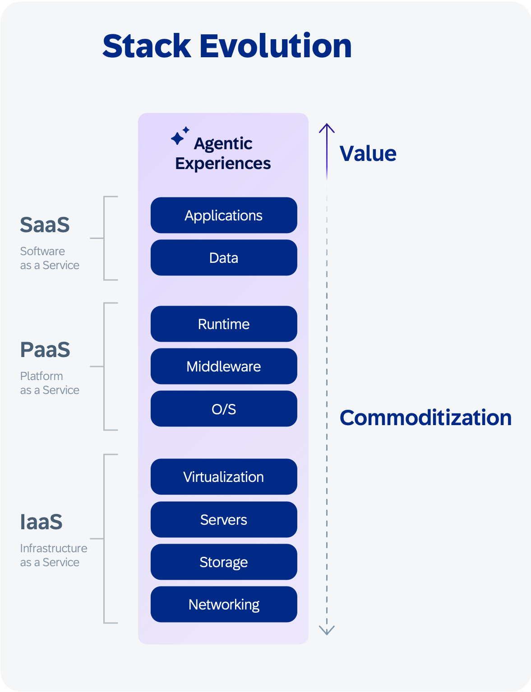
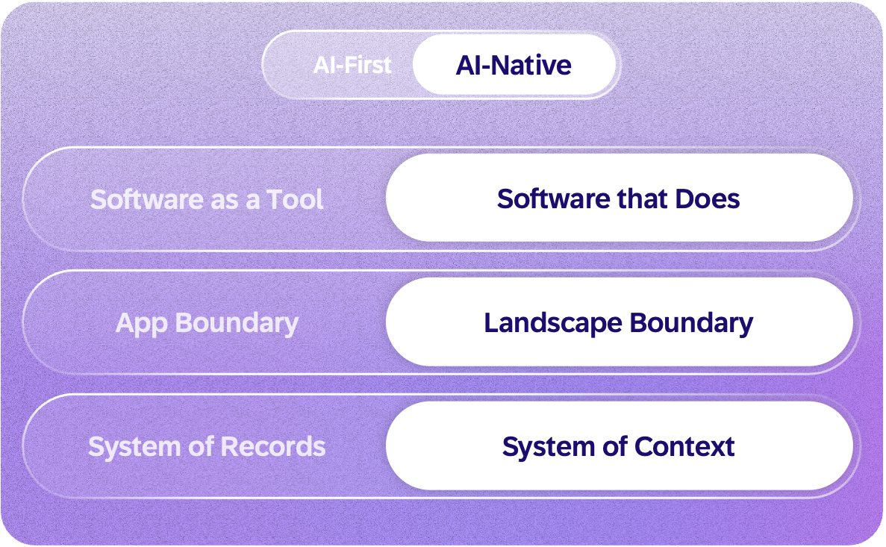
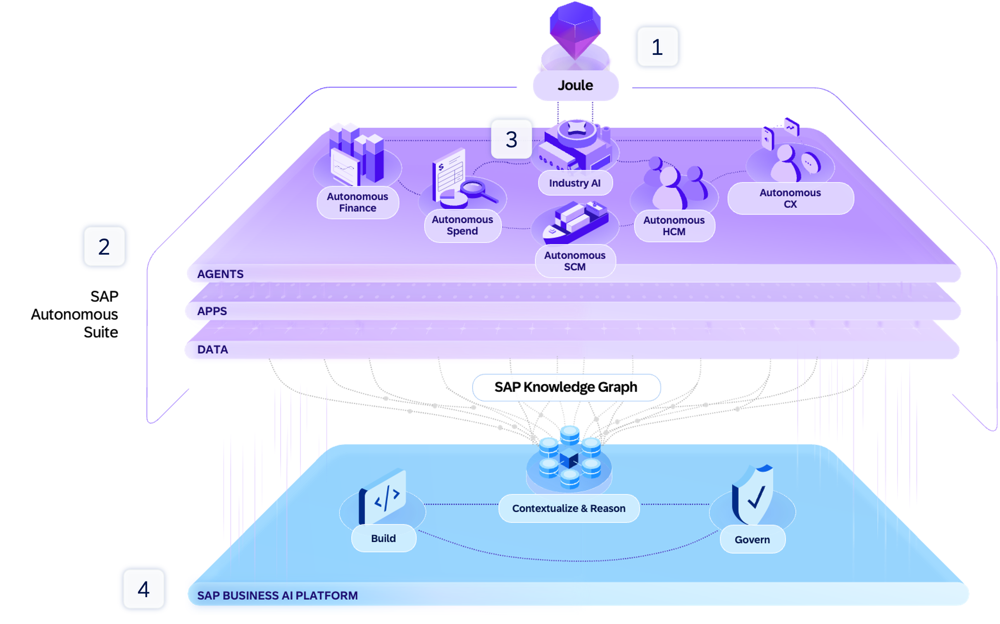
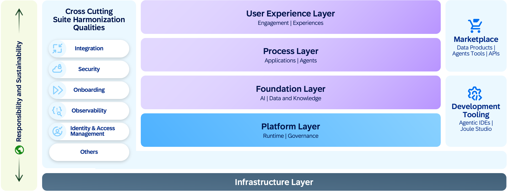
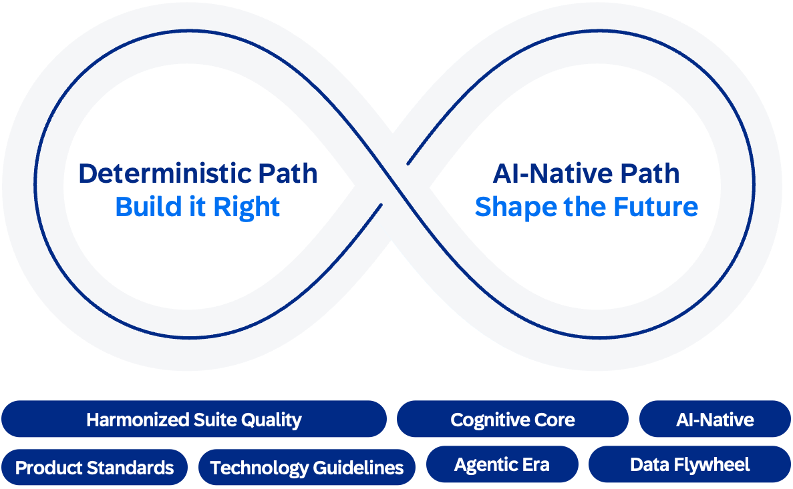

## The trillion-dollar shift
For decades, enterprise software has been a system of record: it stores transactions and facts, enforces rules, and reports what happened. But these elements remain isolated and lack the context needed to explain why decisions were made, what alternatives were considered, or what worked and what didn’t. The reasoning behind enterprise decisions has remained locked in human judgment, scattered across systems, and lost between interactions.

That is now changing. AI makes it possible to build a system of context blended with a system of record: an architecture where enterprise data, process knowledge, and decision history are connected across the enterprise landscape into a shared understanding, so that AI agents can reason over them. Agents participate in decisions as they happen, drawing on the full picture rather than fragments trapped in individual applications. Every correction refines the system. Every interaction adds to it. This learning evolves along three paths. Models advance continuously and supply general reasoning capability, a path broadly available across the industry. Enterprise context compounds and grounds that reasoning in business reality. And the system is designed to learn continually: what is established in one interaction can be retained as governed memory and drawn on in the next, within policy and tenant boundaries, without retraining a model. The system of context adds a compounding advantage that the system of record alone never had.

The opportunity is massive. AI is projected to add $3 trillion to $10 trillion to global GDP in the next decade. Enterprise spending on AI software is expected to reach $452 billion. By 2028, AI Agents task duration is projected to reach a full human workday, currently doubling approximately every seven months ([METR](https://metr.org/time-horizons/)). The trend is about duration, not scope: agents will run longer on bounded tasks, while ambiguity, novel situations, and cross-domain reasoning still require human judgment. The shift is redefining the value stack. Agentic experiences orchestrate outcomes across the enterprise, no longer confined to individual applications. Capabilities below this layer become increasingly commoditized and value shifts from software access to measurable outcomes. As per International Data Corporation (IDC), by 2028 pure seat-based pricing will be obsolete, as delivery models realign around outcomes.

**Industry** is converging toward large-scale agentic platforms built on **distributed and durable AI-native architectures**. These systems rely on strong orchestration across models, agents, and services, persistent shared context, distributed data access, observability and high-performance compute. Market research reinforces this direction. Customers value SAP’s trusted processes and resilient systems, but they also expect acceleration. **The choice is clear: Either we disrupt ourselves, or we risk being disrupted**

The implication is clear: in enterprise AI, context is the **decisive advantage**. Frontier models continue to grow more capable, but model capability alone is becoming commoditized, since every vendor can access the same leading models. What varies is the context over which those models reason. With the right context, software goes beyond predefined paths and reasons toward **outcomes**, application boundaries dissolve, and the enterprise learns. With five decades of business processes, master data, domain knowledge, and industry expertise behind it, SAP has the deepest business context in enterprise software. Just as the harness around a model has become the deciding factor in what AI agents achieve, SAP's business context and the platform around it act as a business harness: the same model, grounded in that context, delivers outcomes the model alone cannot.

When DeepMind's [AlphaGo played Move 37](https://deepmind.google/research/alphago/), no human expert would have considered the strategies it used. Yet it won the game. Systems that learn from their own experience discover approaches beyond human intuition. **Enterprise AI, grounded in five decades of SAP's business context, operating across the full landscape, and acting on business intent, will find its own Move 37**.

## From AI-first to AI-native

SAP’s deep business context creates a unique foundation for reimagining enterprise architecture for the AI-native era. The question is which architecture can unlock it.

In an AI-first world, an AI feature in an ERP system can summarize an invoice or suggest a journal entry. But it operates within the boundaries of a single application. It cannot see that the same supplier has open disputes in service management, delayed shipments in logistics, and a renegotiated contract in procurement.

Three barriers keep AI-first confined. AI systems:
- Lack business and process context, leading to unreliable answers.
- Sit on disconnected systems without a shared data model, so they cannot coordinate across functions.
- Lack the governance to ensure accountability at scale.

**AI-native** solves all three. Software operates across landscape boundaries as a **system of context**, and this is what makes the compounding loop possible in enterprise software. Every interaction feeds intelligence, every correction becomes a learning signal, and the system continuously improves. The delivery model evolves with it: from **software as a service** to **outcome as a service**. Intent-driven, agent-enabled execution learns and adapts continuously. This positions SAP to lead the next wave of AI-native enterprise software, as further described in [SaaS Is Not Dead: It's Evolving](https://sap.sharepoint.com/:w:/t/SAPBusinessAI/EfxvgJTPFw5LnYN5-tok2e0Blw1fFtB6uFxiHQHatjZpqQ?e=nkfZ0k), which shows how SAP’s SaaS foundation accelerates an agentic AI future.

## Leading the next era of enterprise applications toward the Autonomous Enterprise

The Autonomous Enterprise is SAP's vision for the future of how a business runs. It enables companies to respond more quickly, operate more intelligently, and perform better by design, using AI assistants and agents to manage and execute processes across domains in one connected, adaptive system.

SAP delivers this through five reinforcing elements:
- The **Joule** solution as the new engagement layer, bringing together the right data, workflows, and agents across SAP software systems and beyond
- **SAP Autonomous Suite** reinventing how enterprises run, with AI assistants and agents executing work across finance, spend, supply chain management, human capital management, and customer experience
- **Industry AI** portfolio with built-in vertical process knowledge, data models, and regulatory logic
- **SAP Business AI Platform** unifying the SAP Business Data Cloud (SAP BDC) solution, SAP Business Technology Platform (SAP BTP), Business Transformation Management solutions, and the AI Foundation solution to deliver business context, unified data, models, and enterprise-grade governance
- **Accelerated adoption** of the Autonomous Enterprise through the RISE with SAP journey and SAP GROW offerings, enabled by an agent-led toolchain

These elements are realized through an AI-native architecture built on four reimagined layers: user experience, process, foundation, and platform. Together, they form the cognitive core: an enterprise intelligence system that integrates SAP's business data, process knowledge, and reasoning models to enable enterprise systems to learn and adapt.

Cross-cutting **SAP-managed** qualities helps ensure that integration, identity, extensibility, provisioning and observability are harmonized across the suite of SAP solutions. The architecture follows a shift-left and shift-down approach. Shift-left moves quality, security, and compliance checks earlier into design and development, where problems are cheaper to prevent. Shift-down makes shared enterprise qualities part of the platform, reducing what each application team must implement and operate independently. Application teams remain responsible for their business logic and application-specific authorization checks.

**[Responsible and sustainable AI](https://www.sap.com/documents/2025/11/56a1a0fa-2e7f-0010-bca6-c68f7e60039b.html)** is embedded across every layer, ensuring ethical safeguards, transparency, and energy-efficient operations by design. This ensures that the shift to AI native systems elevates trust, accountability, and long-term enterprise value, while respecting planetary boundaries.

This is not a replacement for what already works. SAP pairs two complementary paths: the **deterministic path** to safeguard trust, compliance, and governance and the **AI-native path** to evolve learning systems with data and compute. 

 Kahneman's distinction is instructive here: Deterministic systems are reliable, but rigid. AI without proper context and control can produce confident answers that are wrong. The AI-native architecture addresses this through context engineering, guardrails, and observability. Context engineering supplies the business facts and meaning relevant to the task. Guardrails constrain permitted actions and check outputs. Observability records execution and its results so behavior can be evaluated, reviewed, and improved.

Deterministic systems of record preserve reliability; adaptive systems add insight. Together, they define the architecture for the AI-native era.