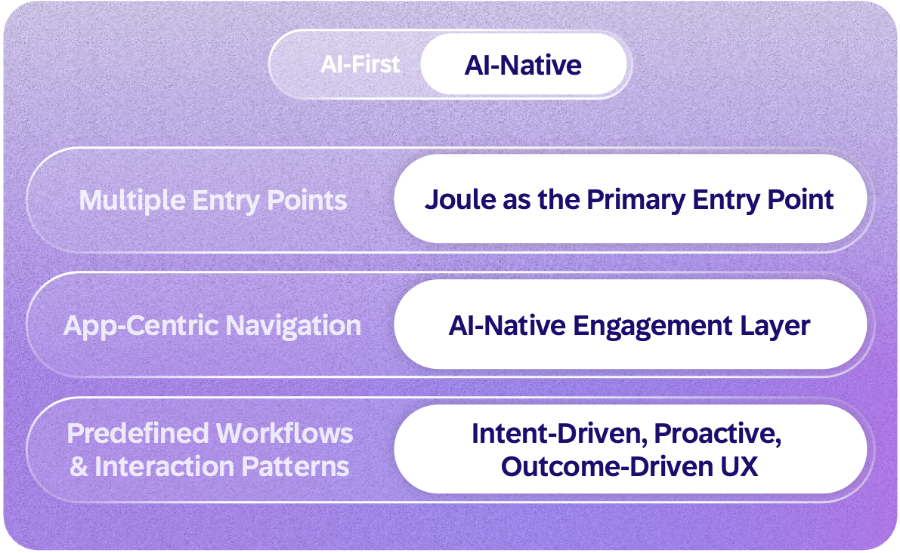
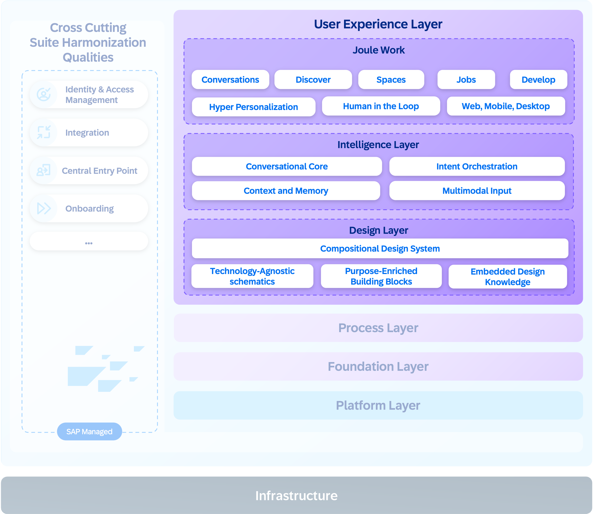
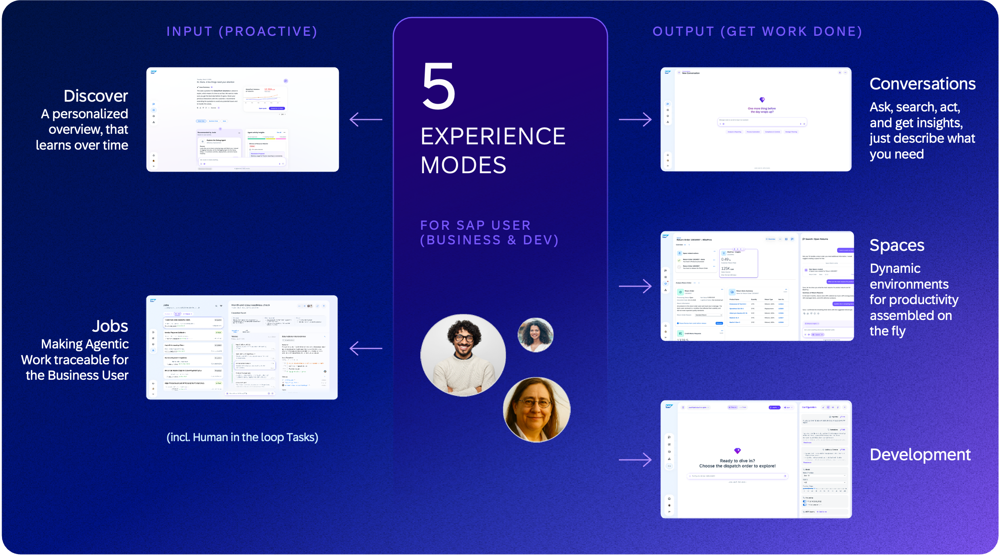

Today, users navigate between applications, follow predefined workflows, and manually piece together information across systems to get work done. AI-native experiences are assembled dynamically, surfacing relevant information and actions specific to each user's intent, context, and goals, rather than being statically designed and delivered to serve the majority.

This requires a fundamental shift in how we design and deliver user experience. Users will no longer navigate to applications but simply state intent, and the system assembles the experience around them. 

All SAP products must contribute to a seamless user experience that helps users work faster, make better decisions, and focus on outcomes rather than navigation.

**Current Foundation**

The unified UX rests on three foundational pillars that simplify design, development, and interaction across SAP’s portfolio.

- The [ONE Design System](https://sap.sharepoint.com/:b:/t/CPAUserExperience/EYDQKtzRoKlKu1s5TStxCBsB4QMcqXVEKkH4ZLJ1iNWRNg?e=Fh5trL&xsdata=MDV8MDF8fDk0NjI5YjE1Y2I1MTRmM2Q2NDgyMDhkYmRmOTYwYjk3fDQyZjc2NzZjZjQ1NTQyM2M4MmY2ZGMyZDk5NzkxYWY3fDB8MHw2MzgzNDk2MDc3MzU2MTY2NDJ8VW5rbm93bnxWR1ZoYlhOVFpXTjFjbWwwZVZObGNuWnBZMlY4ZXlKV0lqb2lNQzR3TGpBd01EQWlMQ0pRSWpvaVYybHVNeklpTENKQlRpSTZJazkwYUdWeUlpd2lWMVFpT2pFeGZRPT18MXxMMk5vWVhSekx6RTVPakpoWmpWallqUmpMVEZsTldZdE5HRTBNUzA0Tnprd0xUYzJNakptTkRjMFl6RmpOMTgzT0dSalpEUTVZaTFsTldOakxUUm1ZVFV0T1Rrd05pMDNNV0ZqTUdFNU4yUTJaalJBZFc1eExtZGliQzV6Y0dGalpYTXZiV1Z6YzJGblpYTXZNVFk1T1RNMk16azNNelF4TlE9PXw3ZjUwMzQ2NDA4YTQ0ZGNiNjQ4MjA4ZGJkZjk2MGI5N3w4ZDNjNWUzYTk0YmQ0NWZlYjZmNzNlODYwYWMwOGI2Mw%3D%3D&sdata=Z2JnclZnamw1OVBJaGx6azVkelV6UWJlMjZDN2tweEp1U2IyNkpjMjE4ND0%3D&ovuser=42f7676c-f455-423c-82f6-dc2d99791af7%2Caxel.schroeder01%40sap.com) addresses customer concerns about inconsistency by providing a unified design framework that consolidates existing guidelines and includes projects like [AXpress](https://sap.sharepoint.com/sites/212013), [Vega](https://wiki.one.int.sap/wiki/display/SFENG2/VEGA+UX+Consistency), and [Lyra](https://wiki.one.int.sap/wiki/display/uxc/LYRA+2026) for enhanced cross-product standards. 
- [SAP Kernel Services](https://pages.github.tools.sap/kernelservices/) eliminates redundant development work by providing shared foundational services like navigation, notifications, and task management, enabling central entry points like SAP Start and SAP Build Work Zone. 
- **The UI Component Strategy** expands [reusable component libraries](https://experience.sap.com/internal/fiori-design-web/web-components-overview/#component-overview) and transitions to an Innersource model where teams collaborate on shared UI elements. Together, these pillars create a consistent foundation that simplifies both user interactions and development processes across SAP’s application suite. Please refer [North Star Architecture Strategy 2024](https://dam.sap.com/mac/app/p/pdf/asset/preview/uQ48mvp?h=&ltr=a) for more information.

The user experience layer brings together three tiers. The **design layer** is the Compositional Design System - a runtime catalog of semantically described UI building blocks governed by layered design rules. AI assembles context-aware experiences from reusable primitives and composites, constrained by those rules to stay on-brand, accessible, and consistent. One declarative spec renders across web, desktop, and mobile clients.

The **intelligence layer** extends these interfaces with adaptive and conversational capabilities, embedding context-aware AI, voice support, and multimodal interaction while maintaining privacy boundaries, transparency, user control, and agency.

The new engagement layer, **Joule Work**, brings these generative experiences together into a unified entry point that interprets intent across natural language, voice, and multimodal inputs to personalize user days, automate routine work within defined guardrails, or turn business intent into agentic solutions. Joule Work will adopt BDC Data Viz for charts and visualizations in its generative experiences. Shared chart definitions will keep the presentation of business data consistent across web and mobile, while each platform renders them through its native components.

These experiences are structured into five experience modes, each serving a particular intent and purpose for users:
- **Conversations** is where users express intent and explore outcomes through continuous dialogue across SAP.
- **Discover** surfaces AI-prioritized tasks, alerts, and opportunities from across connected systems so users can act directly, continue in a Conversation, or open a Space.
- **Spaces** are dynamic workspaces assembled on the fly, bringing together the right data, tools, and context for a specific goal.
- **Jobs** for making agentic work traceable for the business user, automating routine tasks within defined guardrails and escalating to humans for key decisions or missing information.
- **Develop** gives builders the tools to create and deploy agentic solutions using Joule Studio's AI-first development environment. It helps builders discover their enterprise landscape and connect to SAP’s business context, data and interfaces, helping create solutions grounded in their business processes.

SAP Mobile Start evolves as the mobile surface of the Joule Work, providing all five experiences with native controls. This cross-platform, multimodal experience moves toward an omnipresent, app-less interaction model, delivered as an SAP-managed service so SAP can evolve the experience continuously without customer-side effort. Embedded insights from SAP Analytics Cloud bring real-time visibility. Integration with SAP Signavio, SAP LeanIX, and WalkMe adds process transparency and guided adoption.
Customers will be able to bring existing SAP Build Work Zone content, such as application tiles and integration cards, into Joule Work. This will let them adopt the new experience while retaining familiar access to their business applications.
Headless Joule will let customers and partners use Joule through their own interfaces via Agent Gateway's A2A API. Joule Desktop will orchestrate work locally and use Agent Gateway to access SAP applications and tools.

Looking ahead, **voice AI** brings voice interaction to SAP applications, embedded as a core service across mobile and desktop, to make enterprise software as natural as having a conversation while also preserving transparency, user control, and privacy by design.

By embedding semantic meaning into UI components, the design layer composes experiences at runtime around user intent and business context. It draws on named composites, such as KPI tiles, charts with filters, and side-by-side comparisons, with guidance on when to use each. These reusable patterns bring consistency, while lower-level primitives provide flexibility for new needs.

The data layer provides semantic information about the results, including measures and dimensions, along with visualization hints. The design layer determines how to present them. The same semantic specification can render through native components on web and mobile. Together, these capabilities create experiences that explain what happened and why it matters, then recommend the next action, helping users move smoothly from data to decision.

With **physical AI**, Joule moves beyond the screen, bringing business logic from SAP into robotics and smart glasses to enhance the physical world.

While the experience layer allows users to articulate their needs, translating those intentions into tangible business outcomes demands a sophisticated orchestration of applications, intelligent agents, and interconnected business logic, which is the role of the process layer.