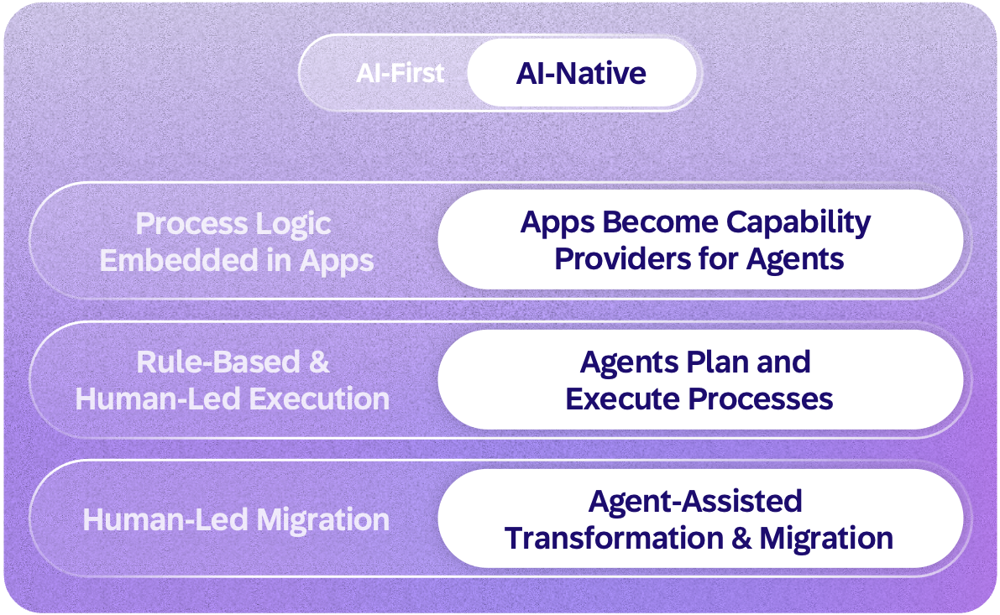
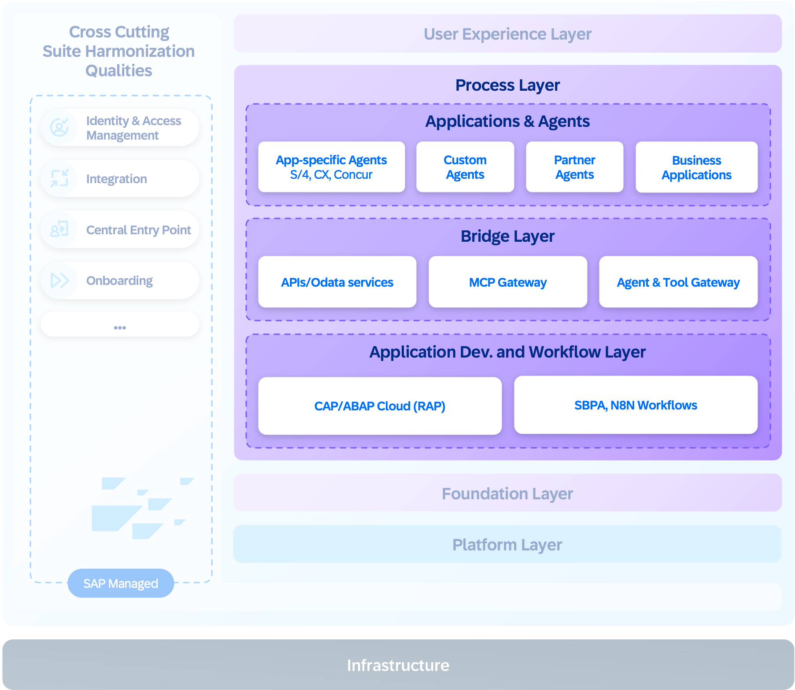
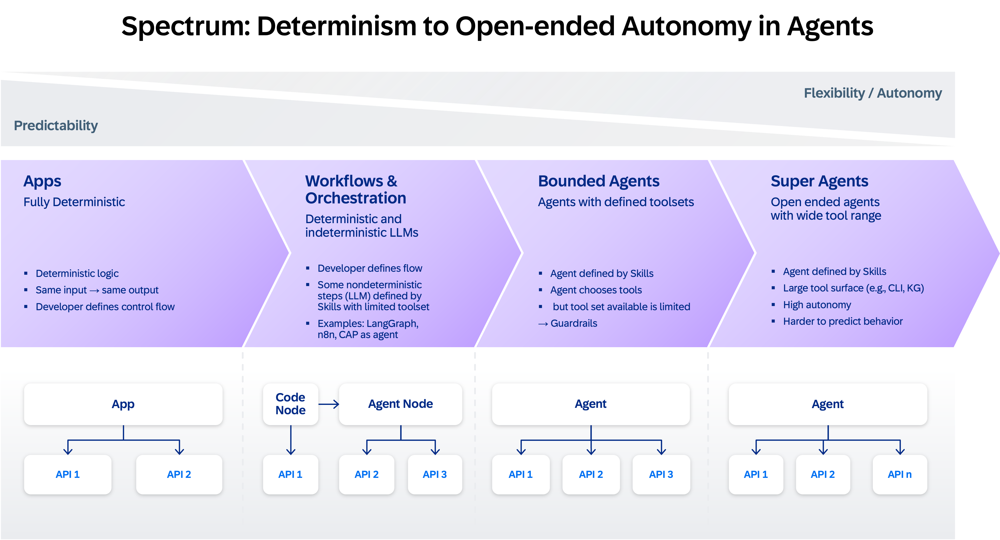
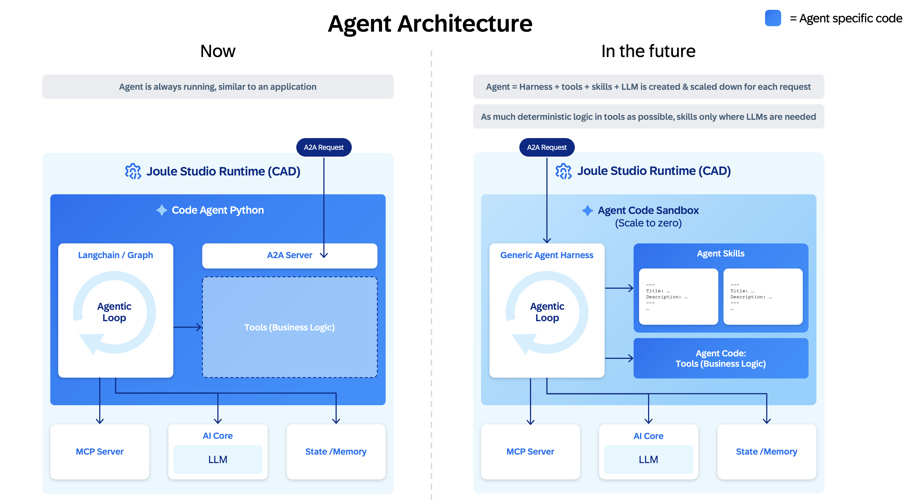
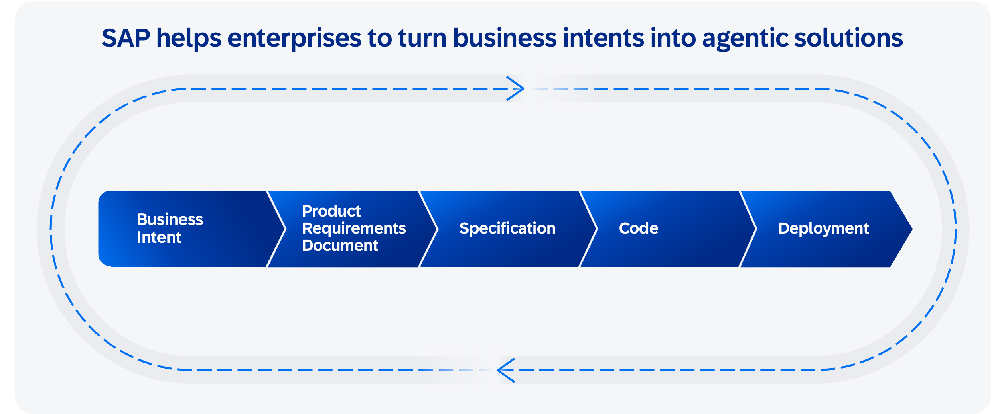

The process layer is where business logic is defined and where the shift from rigid, predefined paths to agent-enabled orchestration takes shape.

A simple request, such as hiring third-party developers, can involve procurement, legal, finance, IT, and supplier management—each with its own systems and approval chains. End-user workflows are constantly evolving and increasingly complex, spanning multiple stakeholders across heterogeneous landscapes. The AI-native architecture transforms how business processes are executed, from logic embedded in applications into a model in which applications, workflows, integration, and agents collaborate to deliver outcomes. 

The shift from AI-first to AI-native redefines how process logic is structured and executed.

In the AI-first model, AI assists process execution within application boundaries: automating steps and suggesting actions but scoped to individual products. In the AI-native model, applications become **capability providers**, exposing stable APIs, events, and data that agents can discover and invoke. This enables business-process innovation through a deliberate mix: AI handles tasks requiring complex reasoning, while deterministic execution helps ensure reliability for specific processes. Both paths extend the reach of the system of context across the enterprise.

Agents follow a reason-act-observe loop to decompose goals, execute actions using tools, and refine based on results. Execution can be optimized through scheduling and reuse strategies that minimize redundant inference and improve overall efficiency. Work can begin with a conversation, business event, or a schedule, and the same access and audit controls apply in each case. When an agent needs approval or more information, the platform routes the request through an active conversation or a tracked task in the responsible person's inbox. The agent can pause until a response arrives.

Agents are organized by business domain, not by individual systems. A procurement agent, for example, orchestrates across ERP, sourcing, supplier management, and third-party systems as a single domain-aware participant. To deliver this, agents need a consistent way to be created, tested, and deployed.

### How agents are built

SAP supports building solutions across the determinism-autonomy spectrum: deterministic apps and workflows for predictable control flow, bounded agents with defined toolsets and guardrails, and open-ended agents for complex reasoning with broader autonomy. Where a task belongs on this spectrum is a design decision, and most solutions combine several points.

Code-based agents can be built directly with a standardized agent software development kit or generated from natural-language intent through assisted authoring (Intent Based Development) in Joule Studio. Both paths produce portable, version-controlled code that can be built and reviewed with standard developer tools (IDEs, text editors and terminals) and / or Joule Studio in the browser and deployed to the same agent runtime.

Agent Skills complement these agents. A skill packages instructions and supporting resources (such as tools) that Joule or another agent loads into its context when needed. Because skills can express instructions in natural language, domain experts can contribute their knowledge without implementing a complete agent. Skills suit conversational work with many variations and knowledge reused across agents. Code-based agents run with their own context and interfaces, and manage their execution and state, making them suitable for high-volume tasks and flows requiring precise control. The two approaches can be combined.

Agents built in Joule Studio are moving toward a skill-based model: a generic, managed agent harness runs the reasoning loop and loads the agent's skills and tools, started for each request and scaled down when idle. Even then, as much logic as possible belongs in tools, because code is cheaper and deterministic, while skills carry only the judgment that needs a language model.

However, real business scenarios rarely involve building and deploying a single agent. A procurement solution, for example, combines an application for purchase requisitions, an approval workflow for spend authorization, and one or more agents for supplier selection and contract compliance. These components are managed as a single deployable solution with a shared lifecycle and dependencies.

All of this comes together in the Joule Studio, the unified design-time environment for building agents and agentic solutions. For rapid prototyping, developers can go straight from intent to code.

For production solutions, the flow progresses from business intent through a product requirements document, specifications, and code generation to deployment, with process knowledge ([SAP Signavio](https://www.sap.com/products/business-transformation-management/process-mining.html)), landscape data ([SAP LeanIX](https://www.sap.com/products/business-transformation-management/enterprise-architecture-management.html)), and domain models ([SAP Knowledge Graph](https://www.sap.com/products/artificial-intelligence/ai-foundation-os/knowledge-graph.html)) from SAP informing each stage. All these documents for intent, product requirements and specifications and the code are generated by AI but can be reviewed and altered by the user at every stage. The documents contain the generated proposal for a solution to the business problem posed in the original intent prompt of the user. The solution and its assets, whether these are agents, workflows, apps, already existing SAP standard tools or all of them combined, are derived from the business context knowledge from the above mentioned products.

Customers can start with intent views and change to code views and tools without rearchitecting, following SAP's [AI Golden Path](../../../golden-path/ai-golden-path/readme.md), which provides comprehensive guidance, from foundation services through agent development to production deployment.

The same approach extends to transformation and migration. In the AI-first model, moving from legacy to cloud is human led and labor intensive. In the AI-native model, agents accelerate code migration, data transformation, and test automation, reducing modernization time, risk, and downtime. Trust and governance for agent interactions, including agent identity, open protocol standards, and governed integration, are detailed in the [Integration, security, ethics, and governance](../7-integration-security-ethics-governance/readme.md) section.

The process layer defines how applications and agents are modeled and evaluated. The foundation layer powers them with data, reasoning, and memory capabilities.