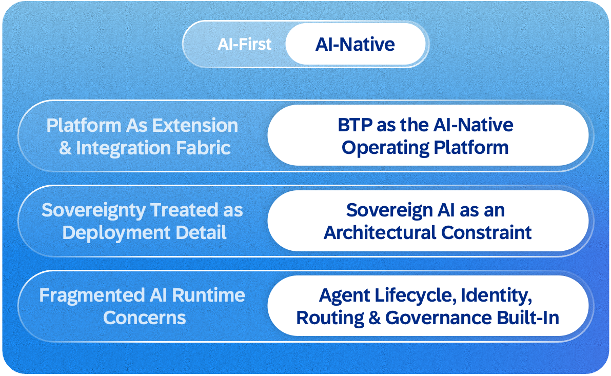
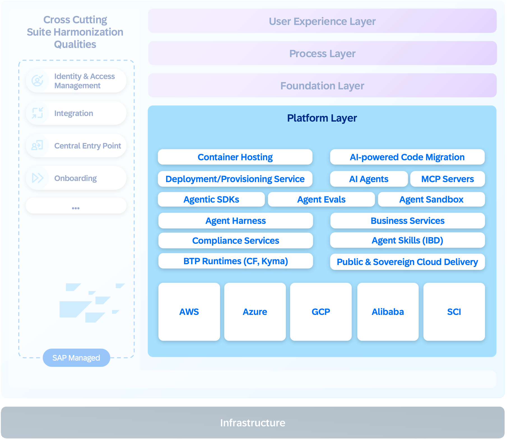

The Platform Layer is where applications, agents and workflows run. SAP Business AI Platform, which includes SAP Business Technology Platform provides composable services across data management, application development, integration, and security. It provides the technical base for SAP’s lines of business, customers, and partners, re-platforming acquired solutions like SAP Ariba Procurement and SAP Business Network onto a unified foundation. This transition simplifies integration, enhances user experience, and reduces total cost of ownership (TCO) and development (TCD) by consolidating capabilities across the suite. With proven scalability, SAP BTP supports millions of tenants globally, delivering the reliability, performance, sustainability and security required for SAP’s enterprise scale.

The shift from AI-first to AI-native expands the platform beyond hosting applications and providing integration. It now supports both deterministic applications and adaptive agents on the same foundation, managing the full lifecycle of agents that operate across both systems of record and systems of context. Sovereign AI is an architectural constraint: agent lifecycle, identity, routing, and governance are built in from the start.

**Service-Centric Architecture**
SAP BTP provides composable services and runtimes across data management, app development, integration, security, and lifecycle management. It has evolved from a runtime-centric platform to a multi-cloud, service-oriented ecosystem where most capabilities work independently of the underlying infrastructure, enabling rapid adoption of new paradigms such as agentic runtimes. **Unified Services** deliver consistent operations across hyperscalers and SAP’s cloud infrastructure, giving developers enterprise-grade services without changing their architecture. This approach preserves SAP’s strengths in reliability, compliance, observability, and security while allowing selective use of hyperscaler or third-party services and continuous adaptation to new workloads and innovations.

**Customer and Ecosystem Experience**
The goal is to provide a seamless SaaS suite experience where customers operate across multiple SAP and partner applications as one coherent system. Within this model, SAP-managed SaaS solutions leverage SAP BTP's integration services like Master Data Integration (MDI), Event Hub, or CIG to enable end-to-end interoperability, or Task Center and Workzone to enable common user experience. Customers continue to use BTP global accounts and subaccounts for application development, extensions, and integrations. At the same time, platform-managed workloads introduce a more structured provisioning model that separates runtime setup from tenant consumption. Runtime environments are prepared and operated within platform-managed contexts, while customer-specific consumption is represented through tenant provisioning and subscription mechanisms.

**Golden Path, Enterprise Qualities, and AI-Native Enablement**
Developers focus on business logic and innovation while SAP BTP guarantees platform consistency and operational excellence. SAP BTP provides Golden Path blueprint for best-practice development in greenfield projects. App Foundation expands Golden Path scope with additional innovations for existing LoB applications, brownfield environments, and streamlined application configuration and deployment.

**Golden Path**applications form building blocks of the intelligent suite. These applications deliver consistent data models, harmonized APIs, and unified lifecycle management, reducing duplication and accelerating innovation. Developers use CDS, Fiori/UI5, RAP and CAP to create extensions, fully supported by PaaS capabilities for connectivity, observability and integration. Customer-facing APIs continue expanding, enabling faster automation and simplified integration.

SAP BTP reinforces data protection and regulatory compliance, meeting strict information security and privacy standards, including **EU Access Only** for sensitive industries. BTP operates in private and sovereign cloud environments. Through BTP Kyma and Gardener, SAP enables AI and LLM workloads on managed Kubernetes clusters in customer or dedicated data centers.

In the AI-native architecture, SAP BTP supports both deterministic and adaptive workloads. Applications and agents participate in platform capabilities such as event-driven integration, observability, and lifecycle management. Event-driven interaction is enabled through a BTP SDK abstraction layer built on SAP Event Hub, following the CloudEvents standard. Event subscriptions and publishing are declared in manifests (AppFnd), ensuring consistent lifecycle handling for both business and technical events.

All workloads share a common observability and metering model based on OpenTelemetry (OTEL), with telemetry routed through OctoRoute and agent execution metered via the Unified Metering Service. App Foundation provides the default managed runtime for SAP-hosted code-based agents across pro-code and prompt-driven authoring, subject to approved exemptions, bringing consistent lifecycle management, observability, scaling, and governance. 

**Application Foundation**

BTP provides the infrastructure, but agents and applications still need a managed layer between raw platform services and business logic. Application Foundation delivers that layer — a unified runtime and development foundation that gives all workloads enterprise qualities out of the box and gives agents a standardized execution model from the start. Whether it is a new agent, an existing LoB application, or a greenfield service, they all share the same lifecycle, security, and operational model without each team reinventing platform integrations from scratch.

**Development Foundation**: Application Foundation (AppFND) gives LoB teams a cohesive development environment so they can focus on business logic instead of platform infrastructure. The BTP SDK handles service access and dependency setup, connecting to Agent Gateway, memory services, and Knowledge Graph out of the box. Reusable business services let LoBs share common capabilities like document management and search rather than rebuilding them, and security is embedded from the start through golden images and automated vulnerability scanning. Integration templates and a managed gateway cover data integrations and migrations. The same foundation extends to agent development - reusable **IBD skills** provide SAP-specific context like process knowledge, landscape data, and domain models as portable assets across coding agents and IDEs. Development follows the **Golden Path (AI & Applications)**, with AppFND extending its reach into existing LoB applications that were not originally built on it. 

### The Managed agent runtime

AppFND serves as the managed runtime foundation for code-based agents, with a standardized execution and lifecycle model. For SAP-hosted code-based agents, the managed runtime on BTP Kyma is the default for both pro-code and prompt-driven creation, subject to approved exemptions.  Its harness connects model reasoning to governed tool access, sandboxed execution, telemetry, and externalized memory. Tenant context is propagated to downstream services, while traffic passes through the Agent Gateway and the Unified Inbound and Outbound Gateways for their respective policy and connectivity controls. In practice, the platform is designed to provide standardized SDKs for building agents in any framework, an agent sandbox for safe development and testing, container-hosted execution, an agent skills registry for discovering reusable capabilities, and continuous evaluations for quality assurance. Each customer's context, memory, and reasoning artifacts are strictly separated from day one, ensuring that one organization's business intelligence never leaks into another's.

**Declarative Lifecycle:** Workloads on Application Foundation are defined through a declarative App.yaml manifest that captures infrastructure, dependencies, and deployment targets as configuration rather than code. This abstraction keeps the interface stable for teams while the platform evolves underneath. **Cloud Orchestrator** handles infrastructure provisioning and continuous reconciliation, while **Deploy with Confidence (DwC)** manages delivery across standardized dev/test/prod landscapes, enabling zero-downtime deployments with multiple concurrent versions. Agent runtime setup is a platform concern, not something each team figures out on its own.

**Scheduled Execution:** SAP Scheduler will provide the shared scheduling service for agents, with Joule Work Jobs showing users scheduled work, run history and execution status. Scheduled invocations will pass through Agent Gateway for access checks, metering and auditability.

**Multi-Tenancy and Isolation:** AI agent frameworks have not yet been proven enterprise-ready for full multi-tenancy, and the risk of cross-tenant data leakage is too high to accept on trust. As a short-term measure, agents run in separate per-tenant deployments. Agents must be built as stateless, tenant-context-aware applications from day one, enabling a seamless transition to a shared multi-tenant runtime without rewrites as the platform matures. The teams implementing agents remain responsible for isolating users within a tenant and for securing how their agents handle state, context, and tools. Separate tenant deployments complement these responsibilities.

**Observability and Metering:** OpenTelemetry is the single observability standard across all workloads. Every managed runtime instance comes with an auto-configured **SAP Cloud Logging** instance and default dashboards, so agent developers get full visibility into logs, metrics, and traces without manual setup. Metering is captured at the runtime level — LLM calls, token consumption, and service usage — making it tamper-proof and independent of agent code. The Agent Gateway classifies each interaction by trigger type — conversational, system-initiated, or external — and metrics flow through OctoRoute to the Unified Metering Service for accurate commercial attribution. Each agent type will use an ORD identifier to link its discovery metadata with governance, telemetry and metering. Tenant and runtime-instance identifiers will show where a particular agent is running, helping operators trace its behavior and attribute consumption correctly.

**Extensibility:** Agent developers will declare which parts of an agent customers and partners can extend: **skills as reusable building blocks, pre/post extension hooks and instructions that pre-condition the agent's behavior with domain knowledge and operating guidelines**. The Extensibility Service will manage extension packages separately from the base agent, so customers can deploy changes without rebuilding the agent container.

**Exemptions and Convergence:** Advanced LoB applications that already operate at proven maturity - elite-level delivery, large-scale multi-tenancy, and full provisioning integration - may request exemptions from the managed runtime. Exempted agents must still comply with guardrails: Agent Gateway is mandatory, provisioning integration is mandatory, and customer experience must match managed-runtime agents. Exempted teams must also register their agents in UMS and provide the required metering and observability integrations. These teams will collaborate with AppFoundation and converge on the managed runtime when its enterprise qualities reach parity with their existing stack.

**Outlook:** The Platform Layer shifts from offering runtimes and services to operating an integrated foundation where agents, applications, and data workloads share the same lifecycle, security, and governance model. Teams can build faster because the platform absorbs the complexity they used to handle themselves - infrastructure, delivery, operations. Whether teams are building agents or applications, they work with the same foundation - one runtime, one lifecycle, one set of enterprise qualities.