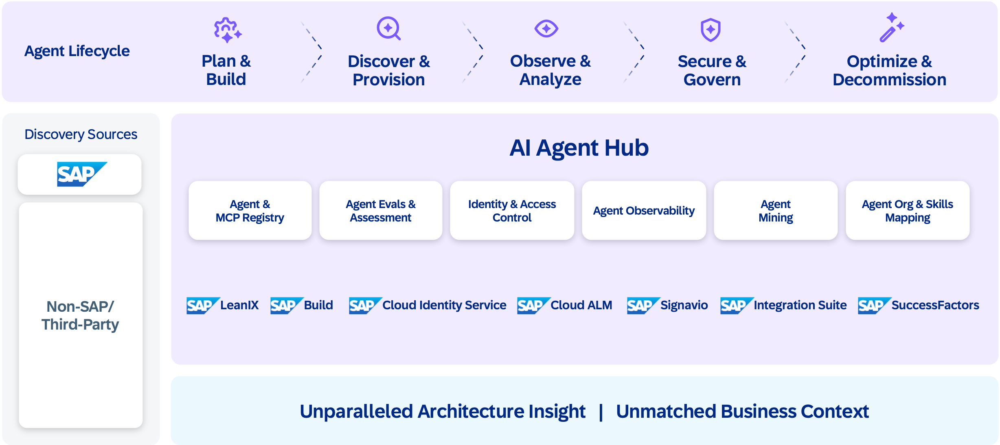

The AI-native enterprise depends on deep collaboration between data, intelligence, and extensions. To enable this, SAP’s Ecosystem Layer creates a unified environment where APIs, data products, agents, and tools can be discovered, connected, and reused. It weaves SAP’s technical marketplaces into a single fabric that drives innovation across products, partners, and industries while maintaining governance, security, and trust.

**The Base: APIs, Tools, and Data Products**

The Ecosystem Layer builds on three interoperable pillars:
- **Firstly**, API Hub ([SAP Business Accelerator Hub](https://api.sap.com/)) and [Open Resource Discovery](https://pages.github.tools.sap/CentralEngineering/open-resource-discovery-specification/) (ORD) serve as the marketplace and metadata bridge for APIs, events, and MCP-compliant tools. 
(Refer [Integration Chapter](../7-integration-security-ethics-governance/readme.md) for details on ORD)

- **Secondly**, SAP Business Data Cloud (BDC) and its Data Product Marketplace deliver curated Data Products — tiered as public, internal, or private — catalogued in the Accelerator Hub and managed through SAP BDC Cockpit. Partners participate through BDC Connect: data platform partners share data bidirectionally, app-building partners contribute data products into standardized landing zones.

- **Thirdly**, SAP Knowledge Graph adds the semantic layer that enables large-scale data access and reasoning. Refer to the Foundation Layer chapter for the BDC, Knowledge Graph, and ontology architecture. (Refer [Data and Knowledge Layer chapter](../5-foundation-layer/readme.md) for details on BDC and KG)

Being callable is not the same as being usable by an agent. Interfaces need to explain what each operation does, what its inputs and outputs mean in business terms, and which permissions are required. APIs and tools organized around business tasks help agents choose the right action. These descriptions cover customer extensions as well as SAP capabilities.

**Marketplace for Agents and Tools**
On top of this base, the Ecosystem Layer introduces a unified marketplace for intelligent components. Agents are registered, versioned, and shared through A2A and MCP protocols, with metadata governed by UMS and ownership tracked from provisioning through to SAP AI Agent Hub: the enterprise hub for discovering and managing agents and MCP servers across the landscape. 

[SAP AI Agent Hub](https://www.sap.com/products/artificial-intelligence/ai-agent-hub.html) manages the full agent lifecycle: from planning and development through discovery and provisioning to observability, governance, and optimization. Agent mining discovers agents that already exist across the enterprise, giving organizations visibility into capabilities they may not know they have. Skills mapping connects agents to the organizational roles and business processes they serve, ensuring the right agent reaches the right user.

Partners build domain-specific agents, a logistics optimization agent, a regulatory compliance agent, a demand forecasting agent and publish them to the marketplace with standardized metadata, quality metrics, and trust ratings. Customers extend SAP-built agents with their own business rules, custom data sources, and industry-specific knowledge.

Reuse will extend beyond complete agents. Business skills will be delivered primarily as agent plugins, bundling related skills with ownership information, dependencies and evaluation assets. Standalone skills and plugins will each be described in ORD, so they can be discovered, governed and reused alongside code-based agents. The harness loads skills and plugins into its execution environment, while code-based agents are invoked through their own interfaces. This lets builders combine reusable knowledge, tools, and independently running agents within the same governed ecosystem.

Every agent in the marketplace follows the same governance model: identity management, authorization boundaries, observability, audit trails, ethics, and sustainability. Whether an agent is built by SAP, a partner, or a customer, it operates under the same trust framework.

**The Path Forward**
The Ecosystem Layer transforms SAP from a suite of applications into a connected network of intelligence. ORD links API Hub, SAP BDC Marketplace, and Agent Metadata Service into a seamless discovery fabric where data, tools, and reasoning interoperate. Developers, partners, and customers build with SAP, co-creating agents, models, and extensions that expand enterprise intelligence. The [SAP Architecture Center](./) connects these innovations through reference architectures and best practices. The result is a network effect: more agents create more capabilities, more capabilities attract more builders, and the ecosystem compounds in value, mirroring the platform dynamics that defined the consumer era and now apply to enterprise intelligence.