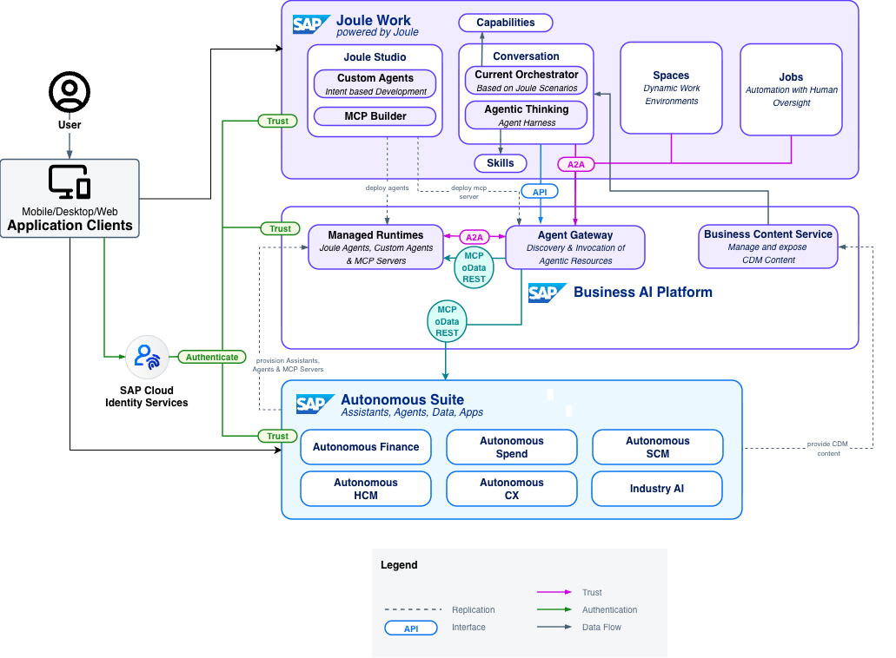
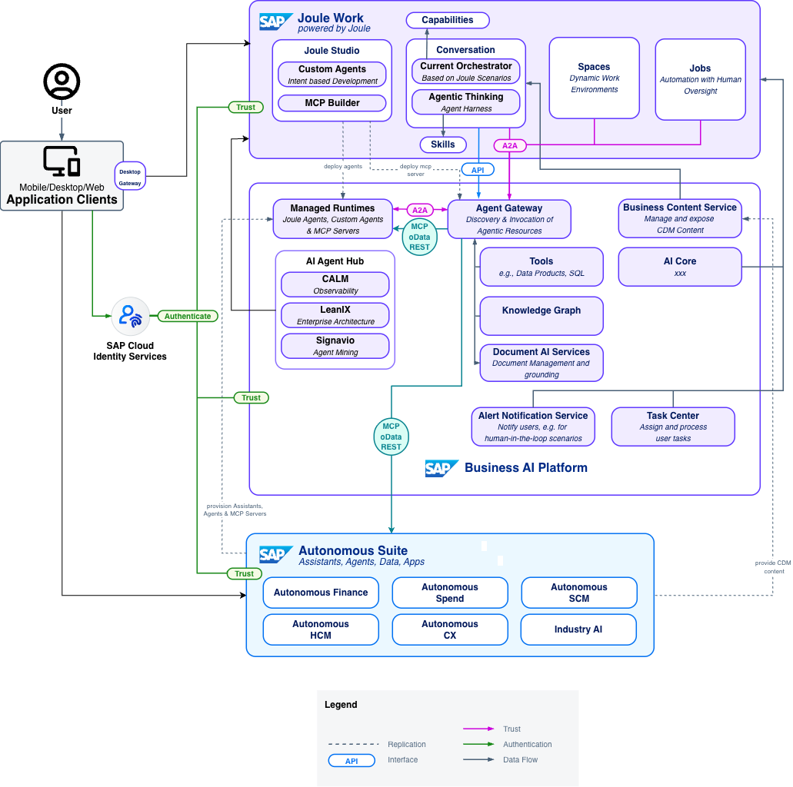

# SAP-Managed Joule

> **Note**
> Some components and capabilities of this reference architecture are not yet generally available (GA) — the current architecture reflects a transitional state highlighting the relevant building blocks for Joule in an SAP-managed setup, coming together with the SAP Business AI Platform.

SAP-Managed Joule is a new provisioning and operational model for Joule Work, creating SAP's new engagement layer experience. In the existing customer-managed model, customers are responsible for ensuring the availability of dependencies, subscribing to Joule in SAP BTP, configuring integrations with SAP solutions, and managing the cloud service after the initial setup. SAP-Managed Joule eliminates this complexity: SAP provisions and operates the full stack, and customers keep control of their landscape with a self-service experience in SAP for Me.

The shift to SAP-managed is more than a simplified setup; it delivers Joule together with the components of the **SAP Business AI Platform**, a comprehensive runtime with all the components required to create value from AI. Customers who provision SAP-Managed Joule get access to the most current Joule innovations, including **Joule Work** with its new engagement layer experience consisting of Conversations, Spaces, and the Develop interface, as well as the **SAP Autonomous Suite** of role- and process-aware AI assistants and agents spanning Finance, Spend, SCM, HCM, CX, and Industry AI.

This reference architecture describes the structure and components of SAP-Managed Joule; how it is provisioned, what it contains, how it connects to SAP backend systems, and how identity and access management is handled. For building and deploying custom AI agents on top of this infrastructure, see [Agentic AI & AI Agents](/ref-arch/98efa0).

## Architecture

The architecture of SAP-Managed Joule consists of two parts: the **SAP Business AI Platform**, a fully SAP-managed, multi-tenant foundation provisioned and operated by SAP, and **Joule**, SAP's portfolio-wide AI solution that delivers intent-driven, end-to-end business process automation across SAP and non-SAP systems. Together they provide everything needed to build and run the Autonomous Enterprise, from the engagement layer and development environment to governed connectivity, grounded data, and enterprise-wide observability.

The simplified solution diagram illustrates the end-to-end setup. Provisioning and activation are managed entirely through **SAP for Me**, which triggers automated setup of all required components regardless of where they run. Customers keep control by defining and building their system landscape based on their needs. Once the setup is done, users access Joule Work through web, desktop, or mobile clients. The diagram shows the web client where Joule Work consists of three parts: Conversations to ask questions, surface insights, and complete business transactions; Joule Studio for agent and application development; and Spaces to dynamically generate workspaces for simple and complex problem-solving. More information on each component can be found in the sub-section for Joule Work.

Backend SAP solutions such as SAP S/4HANA Cloud Public Edition, SAP SuccessFactors solutions, and SAP Ariba solutions are connected to Joule through SAP-managed integrations; the Agent Gateway handles all runtime connectivity with centralized authentication, principal propagation, and policy enforcement. SAP Cloud Identity Services serves as the identity backbone, federating authentication across the full enterprise landscape.

The detailed architecture diagram reveals the full set of SAP Business AI Platform components that come together to deliver the Joule Work experience. Beyond the core connectivity layer provided by the Agent Gateway, the governance layer becomes visible: the **SAP LeanIX AI Agent Hub** for centralized agent governance, versioning, and observability across the AI landscape, and **SAP Signavio Agent Mining** for behavioral tracing and process conformance across agent workflows. The data and AI services tier includes **Business Data Tools** for live business data retrieval and processing, as well as **Document AI Services** for document understanding and processing. Together, these components provide customers with a secure, reliable, and scalable foundation to build and run the Autonomous Enterprise. For the complete component breakdown, see the [SAP Business AI Platform](#sap-business-ai-platform) section below.

### SAP-Managed

SAP cloud solutions can be delivered under two operational models: **customer-managed** or **SAP-managed**. In the customer-managed model, the customer is responsible for technical provisioning, configuration, integration, and ongoing operations. For a BTP-based service like Joule, this includes subscribing in the BTP Cockpit, assigning roles, creating formations, and managing updates. In the SAP-managed model, SAP takes over that operational responsibility: provisioning, patching, security hardening, monitoring, and service continuity are handled by SAP, while customers retain full control over their landscape, business configuration and data.

SAP-managed services are activated and maintained through **SAP for Me**, SAP's self-service customer portal. SAP creates and manages the required BTP infrastructure transparently in the background. Services are kept always current — updates and new capabilities are delivered continuously without upgrade projects, so customers always run the latest version of the solution.

This operational model delivers three practical benefits: a shorter time to value with self-service steps in SAP for Me, a lower operational burden, and for Joule specifically, access to new capabilities that SAP introduces first, or in some cases exclusively, through the SAP-managed model.

### Joule Work

**Joule Work** is a dynamic AI workspace that, based on people's intent, surfaces the right insights, automates routine work, and coordinates AI agents across the enterprise. It is available as a web application, a desktop client, and a mobile app.

Joule Work surfaces four interface modes:

- **Conversations**: a conversational AI interface that enables users to ask questions, surface insights, and complete business transactions. The Joule Orchestrator routes stated intent to the appropriate assistant or agent and returns the result.
- **Spaces**: dynamic, AI-generated workspaces for simple and complex problem-solving. Intent-driven and powered by ready-to-use SAP agents spanning the full suite, Spaces allow users to track and continue multi-step tasks across sessions.
- **Jobs**: allows users to automate routine tasks, ensuring that repetitive processes are handled autonomously while keeping critical decisions within their control.
- **Develop**: a pro-code and low-code environment for building custom AI agents, apps, and automations that run across SAP and third-party systems, powered by **Joule Studio**. Joule Studio is SAP's AI-native development environment, grounded in SAP business context and deployed to the SAP-managed runtime. It replaces the Joule Studio classic edition available through SAP Build.

Joule Work coordinates work through **Joule Assistants** and **Joule Agents**. Joule Assistants are aligned to business roles and processes, coordinating agents to turn isolated tasks into connected workflows with proper oversight and governance. Joule Agents use business process expertise to reliably execute well-defined multi-step tasks across SAP and third-party systems, connecting the relevant data, tools, and applications across the enterprise. Orchestration operates in two modes: the **Joule Orchestrator** is the current Joule capabilities-based engine that handles more deterministic intent routing and capability invocation, designed for well-defined, guided scenarios; the **Agentic Thinking mode (Agent Harness)** is a multi-step reasoning engine for complex agentic tasks it plans and executes across multiple steps, loads skills and tools dynamically, and manages the full agentic workflow lifecycle including human-in-the-loop checkpoints.

### SAP Business AI Platform

The **SAP Business AI Platform** is SAP's enterprise AI foundation providing the infrastructure, data intelligence, and governance required to run trusted AI at enterprise scale. It is built on enterprise-grade security, governance, and data frameworks and is deeply integrated with SAP's business applications and process knowledge. When SAP-Managed Joule is provisioned, the platform is delivered as an integrated bundle; customers do not need to assemble or operate its components independently.

#### Agent Gateway

The **Agent Gateway** is the central integration and routing layer of the SAP Business AI Platform. It handles all runtime connectivity between Joule, agents, and backend tools and systems with centralized authentication, principal propagation, policy enforcement, and tenancy management at every communication hop.

Key capabilities of the Agent Gateway:
- **Discovery and Invocation** — locates and invokes agentic resources (skills, tools, MCP servers, agents) across the platform.
- **A2A protocol support** — routes agent-to-agent communication using the open Agent-to-Agent (A2A) standard.
- **MCP protocol support** — exposes and consumes tool capabilities using the Model Context Protocol (MCP).
- **Security enforcement** — applies the intersection of user permissions and agent permissions at every call, preventing privilege escalation.

#### Desktop Gateway

The **Desktop Gateway** is the connectivity component that enables the Joule Work Desktop client to access SAP backends. It acts as the bridge between the desktop client and the Agent Gateway, ensuring that all backend calls from the desktop surface are routed through the platform's centralized connectivity and security layer, consistent with how other Joule Work clients communicate with backend systems.

#### Business Content Service

The Business Content Service is an embedded headless kernel that provides Joule with role- and navigation-aware business context. BCS is the authoritative source for launchpad configuration, role assignments, and application navigation data, replacing the prior dependency on SAP Build Workzone as the host surface for this context. It enables the Joule Orchestrator to surface contextually relevant actions and applications based on the authenticated user's roles and permissions, without requiring a Workzone subscription.

#### Business Data Tools

The SAP Business AI Platform exposes specialized data-retrieval tools that the Joule Orchestrator invokes at runtime to ground agent responses in live business data. These tools to e.g. access BDC Data Products or generate SQL are registered with the Agent Gateway and called transparently during intent processing; end users do not interact with them directly.

#### SAP Knowledge Graph

The **SAP Knowledge Graph** is a dedicated platform component that retrieves contextually relevant business information based on user intent. It models relationships across SAP business objects, master data, and process knowledge, enabling the Joule Orchestrator to surface insights that go beyond flat data retrieval. The Knowledge Graph is invoked at runtime as part of the grounding layer, alongside the other Business Data Tools.

#### Document AI Services

**Document AI Services** extend the SAP Business AI Platform with the ability to process, understand, and index business documents. The service covers two primary capabilities: **Document Management**, which handles the storage and lifecycle of business documents within the platform, and **Document Grounding**, which makes document content available to the Joule Orchestrator at runtime so that agent responses can be grounded in unstructured content such as customer-uploaded documents, contracts, and business forms alongside structured SAP data.

#### Task Center

The **SAP Task Center** integration connects Joule's agent workflows to SAP's cross-solution task inbox. When an agent reaches a decision point that requires human judgment, approval, or input, it surfaces the request as a task in the Task Center, enabling human-in-the-loop oversight across end-to-end business processes without requiring users to navigate individual back-end applications.

#### Alert Notification Service

The **Alert Notification Service** enables the SAP Business AI Platform to push proactive notifications to business users when agents detect changes, anomalies, or situations requiring attention in the Autonomous Enterprise. Alerts are delivered through configured channels, ensuring users stay informed and can intervene or take action at the right moment without actively monitoring individual systems.

#### SAP Signavio — Agent Mining

SAP Signavio provides observability and continuous improvement capabilities for AI agents. Agent Mining delivers behavioral tracing, process conformance analysis, performance benchmarking, and business impact measurement across the agent landscape.

#### SAP LeanIX — AI Agent Hub

The **SAP AI Agent Hub** (powered by SAP LeanIX) is a vendor-agnostic command center for the discovery and governance of AI agents, LLMs, and MCP servers across the enterprise. It maintains a structured, versioned registry of all AI assets grounded in their architecture and business context. 
