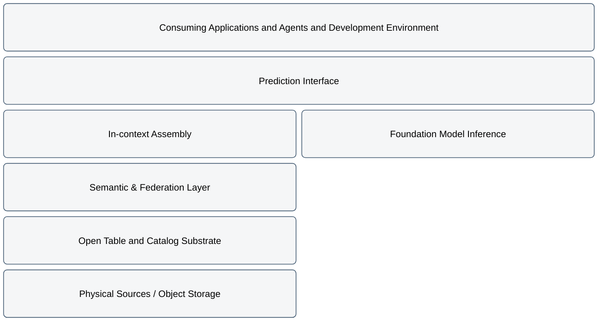

# Training-Free Predictive Analytics over a Semantic Lakehouse

Predictive analytics in enterprise settings has traditionally required per-use-case training pipelines: feature engineering, feature stores, training runs, model registries, and retraining loops. Tabular foundation models give us a training-free approach and remove the need to copy data, run per-tenant training runs, and host a large number of small models. Deleting the training stage does not remove work, it relocates it. The work moves left, out of a model-training-and-serving pipeline and into the assembly, governance, and semantic correctness of the table handed to the model per inference request. The lakehouse that owns that table is promoted from a convenience layer to the critical path.

## Architecture

The logical architecture is a small set of layers, described by responsibility rather than product. It is a horizontal flow from sources to consumers, sitting on an open, engine-neutral substrate.

| Logical Layer | Description |
|---|---|
| Consuming Applications and Agents | Request predictions by issuing a request against a named, governed prediction interface, not against raw tables and not against a model endpoint directly. |
| Prediction Interface | Thin, stable contract: given an entity (or set of entities) and a predictive task, return a prediction with provenance. It hides model identity and assembly from callers and carries the SLA. A tabular foundation model and a relational foundation model become substitutable behind this one interface. |
| Foundation Model Inference | Training-free predictor: a tabular FM consuming a flat labeled context table plus query rows, or a relational FM consuming a multi-table subgraph plus a predictive query. It is stateless with respect to the task and is a shared, centrally operated capability, not a per-team artifact. |
| In-context Assembly | Turns a request into the exact input the model needs: selects the context (labeled examples for in-context learning), assembles the query rows, applies point-in-time correctness so no future information leaks, and shapes the payload. This does at request time most of what feature engineering used to do offline. Context can be built freshly per request from the semantic layer, or retrieved from a pre-registered, reusable context set (a tabular context registry); either way, context selection is a first-class, governed responsibility. |
| Semantic & Federation Layer | The heart of the architecture, on the critical path of every prediction. It owns the semantic definitions (entities, relationships, metrics, the meaning of each field), federation over multiple physical sources without mandatory copy, governance enforcement (row/column access control, PII masking, purpose limitation), lineage and provenance, and an explicit freshness contract. Because there is no downstream pipeline to embed governance in, governance lives here. |
| Open Table and Catalog Substrate | Durable, engine-neutral storage contract underneath: an open table format (Apache Iceberg), an open catalog implementing the Iceberg REST spec (Apache Polaris) for discovery, schema, and snapshot/version metadata, and columnar transport (Apache Arrow, Arrow Flight) for moving assembled context to the model. This substrate is what makes "the semantic layer is the critical path" survivable: the query engine above it is replaceable because the contract below it is open. |
| Physical Sources | Hold the actual data. Some are federated in place; some are landed as Iceberg tables. |

The single most important structural consequence: the semantic/federation layer sits on the request path of every prediction, not off to the side of a batch training job. Its latency, correctness, and governance become the system's latency, correctness, and governance.

## Flow

An agent developer builds a predictive capability against a data product directly from Joule Studio.

1. **Discovery.** Search the Enterprise Catalog for an existing predictive view or data product covering the task.
2. **Explore the dataset.** Inspect the data product: schema, semantics, freshness, candidate target column.
3. **Find the model and configuration.** Use Model Eval (development MCP server) to identify the best model family, context size, and sampling strategy.
4. **Create predictive context**
  - **4a. Create a predictive view.** Create a Dremio view, expressing the prediction as a governed view rather than a separate endpoint.
  - **4c. Optionally expose as a derived data product.** Register the predictive view in the Enterprise Catalog so other builders discover and reuse it at step 1.
  - **4b. Register context.** Alternatively, register the labeled context set in the AI Core tabular context registry.

   The tradeoff between 4a and 4b: the context registry (4b) buys retrieval latency and reuse across agents at the cost of a curation and freshness step that must itself be governed against point-in-time correctness. The predictive view (4a) assembles context fresh per request from the semantic layer, keeping governance in one place but paying assembly latency on every call.
5. **Implement the agent.**
  - **5a.** Wire the agent to call the tabular foundation model through the predictive view (follows 4a).
  - **5c.** The predictive view calls AI Core tabular foundation models (eg TabPFN).
  - **5b.** Wire the agent to call the tabular orchestration service, which handles context retrieval and model invocation in one operation (follows 4b).
6. **Deploy the agent.** Deploy through the Joule Studio.

### What is absent from every flow

No training job. No model-registry promotion. No feature-store offline/online sync. Adding a new use case means defining a new task and assembly specification against the existing lakehouse, or discovering an existing predictive data product in the catalog.

## When to use

- Multiple predictive tasks share the same governed data - the semantic layer and context assembly are reused across tasks without retraining.
- Per-tenant training budgets are unavailable, impractical, or too slow for the use-case onboarding rate required.
- SAP source data cannot be copied or moved to an external training pipeline; federation in place is the only compliant path.
- Governance enforceability is a hard requirement: a single policy change (PII masking, role revocation) must propagate to every prediction path, including inline views and agent calls.
- A materialized serving path is acceptable for latency-sensitive requests; the architecture accommodates a thin cache in front of the semantic layer without reintroducing a separate feature store.

## Characteristics

1. **Governance on the critical path.** The semantic/federation layer sits on the request path of every prediction. Its latency, correctness, and governance become the system's latency, correctness, and governance. There is no parallel pipeline where governance is optional.

2. **Training-free inference.** The training loop, model registry, and offline feature store are removed. "Retraining" collapses to re-querying the semantic layer with updated data. Use-case onboarding effort drops to defining a new task and assembly specification.

3. **Model-family neutrality.** Tabular FM (flat labeled context table) and relational FM (multi-table subgraph) both sit behind the same prediction interface and Agent Gateway. The difference is confined to in-context assembly and what shape the semantic layer exposes.

4. **Open substrate portability.** The storage contract — Apache Iceberg tables, Polaris catalog (Iceberg REST), Arrow Flight transport — is engine-neutral. The query engine above it is replaceable without touching tables or catalog.

5. **Point-in-time correctness without a feature store.** Correctness moves to in-context assembly, enforced against versioned Iceberg snapshots rather than against a feature store's event-time tables.

## Examples

- **Customer churn.** Predict churn risk per customer over a governed view of CRM and usage data; no per-segment retraining when customer mix changes.
- **Late-payment / DSO risk.** Score open receivables for payment risk using labeled historical payment data federated from SAP S/4HANA in place.
- **Service-ticket escalation.** Predict escalation likelihood from ticket metadata and resolution history; same semantic layer as churn, different task specification.
- **Demand forecasting.** Forecast demand over federated sales and inventory data with point-in-time correctness enforced against Iceberg snapshots.

## Services and Components

- **[SAP Business Data Cloud](https://www.sap.com/products/data-cloud.html)** — Unified lakehouse combining SAP and non-SAP data across hybrid and cloud environments. Hosts the governed semantic layer, Enterprise Catalog Powered by Polaris, and data products that serve as the model's data contract.

- **[SAP AI Core](https://discovery-center.cloud.sap/serviceCatalog/1f756a52-8968-4ec4-92d0-f9bddf552ea3)** — Hosts RPT-1.5 and TabPFN as training-free predictors. Provides the tabular context registry, Model Eval, and Agent Eval capabilities.

- **Apache Iceberg + Apache Polaris** — Open table format and Iceberg REST catalog providing engine-neutral, versioned storage. Enables point-in-time correctness via snapshot queries and safe Premium API exposure to external platforms.

- **Joule / Agent Gateway** — Orchestration and gateway layer through which agents and Joule Work invoke the prediction interface. Enforces authorization and routes calls to AI Core.

## Open Design Questions and ToDos (to be removed before publication)

- Does the prediction interface expose a synchronous per-entity call, a batch-scoring call, an inline PREDICT_AI view, or all three, and does that choice change where materialization must sit?
- Is point-in-time correctness cheap to enforce against Iceberg snapshots at request time, or does it force a materialized path for most real SLAs? (This directly tests the "training-free removes the feature store" claim.)
- What exactly does the Agent Gateway enforce that the semantic layer does not, and does putting it on the path add a governance choke point or a second one to keep in sync?
- For relational FMs, how much governance can be expressed over a subgraph vs a flattened view without leaking relationships that policy forbids?
- Where does monitoring for semantic drift live, given there is no training run to attach validation to, and how do Model Eval and Agent Eval cover it?
- When context is served from the registry rather than assembled per request, who owns its freshness and point-in-time correctness, and does registration reintroduce a governed offline step through the back door?
- What catalog capabilities are needed to register a predictive derived data product (permanent flow) so it is discoverable and reusable?
- What is the minimal open contract (Iceberg + Polaris + Arrow) that guarantees engine portability and safe Premium API exposure, and what breaks it in practice?
- What capabilities are available right now - predictive predicates in Dremio only available as preview and for RPT
- Reference SAP Help documentation more precisely (Tabular Context Registry)
- Cross-Reference AI Golden Path (preference to Tabular Foundation Models is already expressed there)
- Where is the Model Eval MCP server deployed?

## Resources

- [SAP Business Data Cloud documentation](https://www.sap.com/products/data-cloud.html)
- [SAP AI Core documentation](https://help.sap.com/docs/ai-core)
- [Apache Iceberg](https://iceberg.apache.org/)
- [Apache Polaris](https://polaris.apache.org/)
- [TabPFN](https://github.com/PriorLabs/TabPFN)

## Related Architectures

- [Federated Machine Learning with SAP Datasphere](/ref-arch/17c8c5)
- [Explore your Hyperscaler data with SAP Business Data Cloud](/ref-arch/b27373)
- [Transforming Enterprise Data Strategy with SAP Business Data Cloud](/ref-arch/e1732d)
- [Agentic AI & AI Agents](/ref-arch/ra0029)
