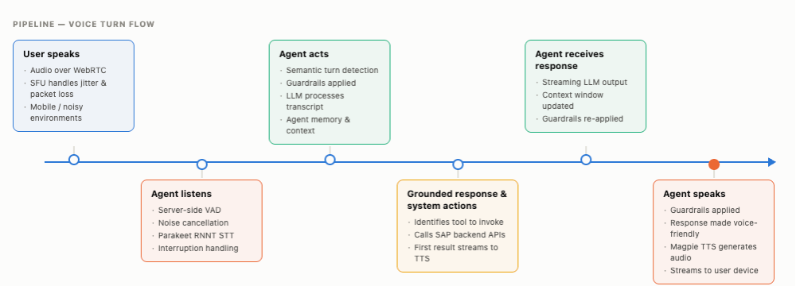
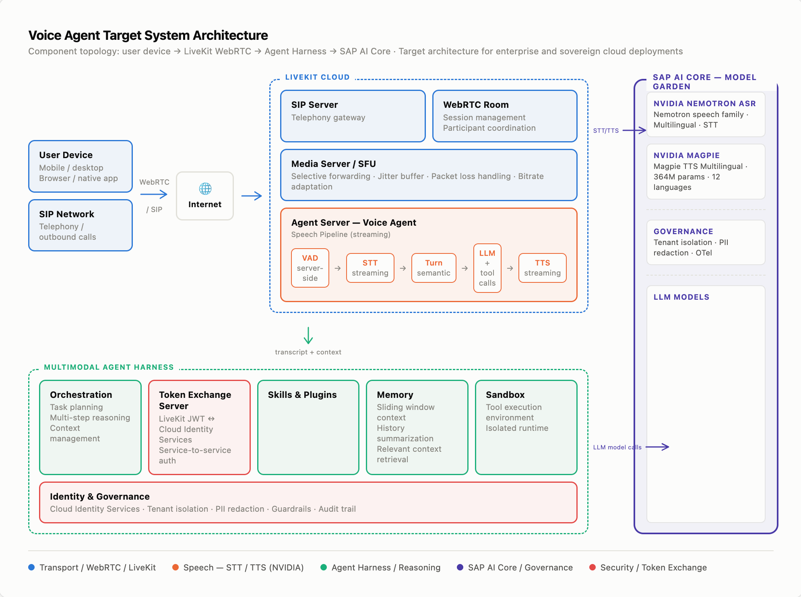

*The statements in this article about planned features, timelines, and availability are forward-looking and subject to change. They are not a commitment to deliver any specific functionality and should not be relied upon in making purchasing decisions.*

## Designing Voice Agents for Enterprise Requirements

A voice agent that books a flight in under five seconds makes a compelling demonstration. Getting that same agent to work reliably for a sales representative booking travel from a moving car, or a procurement manager on a factory floor reviewing a supply chain exception in German over a mobile connection, is a different engineering problem entirely.

<!-- truncate -->

Human perception sets a hard constraint: conversations feel natural below 500 milliseconds of end-to-end latency. Responses up to two seconds feel like a thoughtful pause. Beyond four seconds, users start abandoning the interaction. In our testing at SAP, the baseline we measured sat between two and four seconds, before accounting for network jitter, custom enterprise vocabulary, multilingual input, or the compliance controls that govern what an AI system can say and store.

Moving from a demo to production requires both accurate speech models and an architecture designed for real enterprise conditions: how you structure the pipeline, where you run the models, and how you handle the cases that never appear in a controlled environment. This article describes what we learned building voice capabilities for enterprise production, the trade-offs we made, and the design patterns that made the difference.

## Why SAP Chose a Cascading Pipeline

Our first voice agent used WebSockets for the client connection and a real-time speech-to-speech model for inference. In a controlled demo, it worked. Under production conditions (users on mobile networks, variable bandwidth, occasional packet loss), the experience degraded: audio quality dropped, turn detection misfired, and the single-model architecture gave us nowhere to intervene.

We rebuilt around a WebRTC transport layer and a cascading pipeline with separate components for speech-to-text (STT), large language model (LLM), and text-to-speech (TTS). The voice agent runs inside LiveKit Cloud, a WebRTC media layer that handles transport, jitter, and packet loss before audio reaches the speech pipeline. An Agent Server processes voice through a streaming cascade: Voice Activity Detection (VAD), STT, semantic turn detection, LLM with tool calls, and TTS. STT and TTS inference routes to NVIDIA Nemotron speech models via a custom SAP AI Core plugin, while the Multimodal Agent Harness handles orchestration, memory, and LLM calls.

The STT model selection itself illustrates why this modularity matters. We initially tested NVIDIA Parakeet RNNT for its multilingual support but found latency that exceeded our budget for real-time voice. We pivoted to Parakeet CTC 1.1B to isolate and optimize the latency profile, running extensive benchmarks, vocabulary analysis, and production sizing jointly with NVIDIA and the SAP AI Core team. That work produced meaningful findings on word error rates for SAP-specific terminology, identified a significant set of consistently misrecognized terms, and confirmed that vocabulary boosting can close the gap without retraining. We plan to publish detailed benchmark results jointly with NVIDIA as evaluation on the target model matures. We are now adopting NVIDIA Nemotron 3.5 ASR, which combines the multilingual coverage our global customers require with the latency characteristics we validated with Parakeet CTC 1.1B. The benchmarking methodology, vocabulary configurations, and production sizing all carry forward to the new model.

### The Trade-offs Behind Our Architecture Choice

A speech-to-speech model handles the full pipeline in a single pass. The latency advantage is real, but there are also trade-offs:

- **Context window.** Enterprise voice conversations often span ten or more minutes, and each tool call adds to the accumulated context: the request, the response payload, intermediate reasoning, and conversation history. Enterprise system responses tend to be verbose; a single call to a procurement or ERP system may consume significant context on its own. Current speech-to-speech models have constrained context windows that limit this.

- **Turn detection.** VAD answers "is the user making sound?" Turn detection answers "has the user finished their thought?" Getting either wrong has a measurable cost: cut off too early and the agent dispatches a tool call on incomplete input; wait too long and the conversation develops an unnatural lag. Enterprise users amplify both failure modes. A technician recalling a fault code, a procurement manager working through a multi-step exception, and a non-native speaker mid-construction all produce pause patterns that a fixed acoustic VAD model misreads. Semantic turn detection reduces these misclassifications significantly. In a cascading pipeline, this component is independently swappable, and for our implementation it gives us more direct control over conversational boundaries.

- **Custom vocabulary.** If the STT model transcribes a transaction code incorrectly, the LLM reasons from faulty input and every downstream action may be wrong. SAP terminology compounds this: transaction codes like SE38, abbreviations like ATC (ABAP Test Cockpit), G/L account (General Ledger Account), and industry jargon that varies by vertical are not recognized correctly by general-purpose models. In a cascading pipeline, vocabulary boosting and custom pronunciation dictionaries can be applied at the STT layer without fine-tuning the base model. The same correction applied at TTS ensures the agent pronounces terms correctly when speaking back. Separate STT and TTS components give us explicit intervention points for vocabulary and pronunciation.

- **Model substitution.** All model access for SAP and its customers runs through SAP AI Core. LiveKit's plugin architecture makes each stage of the pipeline modular. Different STT and TTS models perform differently across languages and accents: a model that handles English well may produce significantly higher word error rates on German or Mandarin. If a model is experiencing issues, the pipeline degrades gracefully to an alternative rather than failing the interaction.

For our enterprise requirements, a cascading pipeline provides direct control over individual components, making it easier to evaluate, customize, and replace them independently. We will continue to assess speech-to-speech approaches against those same requirements.

The broader industry appears to be reaching a similar conclusion. A [2026 survey of voice agent architectures](https://frenchydigital.com/blog/voice-ai-agent-architecture-2026) found that cascaded pipelines continue to provide better production outcomes. Unified speech-to-speech models can reduce stitching latency, but they currently offer less control at each stage and can create greater vendor dependency.

### Production failure modes

Controlled environments hide failure modes that surface only when real users arrive:

- **VAD and turn detection false positives.** Background noise (factory floor, moving car, open-plan office) triggers speech detection and interrupts the agent mid-response. Layered detection addresses this: [Silero VAD](https://docs.livekit.io/agents/logic/turns/vad/) as a first pass to detect user voice, [semantic turn detection from LiveKit](https://docs.livekit.io/agents/logic/turns/turn-detector/#audio-turn-detector) as the gate. We are looking into adding [noise cancellation modes](https://docs.livekit.io/transport/media/noise-cancellation/#frontend) to isolate noise from user utterance to reduce false positives.
- **Agent timeouts.** When a backend tool call exceeds the latency budget, the user hears silence. Silence in a voice conversation reads as a dropped call. The mitigation is streaming meaningful intermediate updates grounded in what the backend has returned so far, not generic fillers.
- **Offline evals are insufficient.** Curated test sets do not capture real conversation dynamics: distracted users, non-native speakers, sleep-deprived operators. An automated eval loop that feeds production transcripts into an LLM-as-judge pipeline with a human in the loop is one way to measure quality continuously against what users actually say.

## The Latency Budget

What the user feels is **Time to First Audio (TTFA)**, the gap between the end of their turn and the first audio the agent speaks. It is the sum of four components:

1. **ASR final-transcript latency** is the time from the end of the user's speech to the first transcript, which is the STT contribution.
2. **LLM Time to First Token (TTFT)** is the time from the final transcript to the first generated token.
3. **TTS Time to First Byte (TTFB)** is the time from the first sentence reaching TTS to the first audio byte.
4. **Endpointing and orchestration overhead** covers turn detection and the glue between the components.

In one of our use cases, measured TTFA is about 2 seconds without a tool call and 3 seconds or more when a tool call is involved. The breakdown below shows where the time goes. STT compute is only about 300 ms, so improving it by 20% saves roughly 60 ms. That is negligible next to a tool call that typically runs a second or longer, or an LLM first-token latency of 0.9 to 1.7 seconds. The clearest wins come from cutting tool-call round-trip time and routing simpler turns to a lower-latency LLM.

Two levers matter most:

- **Stream at both ends.** Streaming LLM output to TTS sentence by sentence hides generation latency beyond the first sentence, and streaming audio playback before generation completes shortens what the user actually waits for. A pipeline that streams at both ends delivers a TTFA well below the total time the system spends generating. That gap, between what the system computes and what the user perceives, is where most latency optimization lives.
- **Place infrastructure close.** Co-locating the agent server with the model garden (same region or a dedicated low-latency tunnel) removes a full network round-trip from every inference call. We are currently working to bring round-trip network latency from ~200-300ms down to ~20-30ms.

## Why Self-Hosted Open Models Make Sense for SAP

Choosing a cascading pipeline leads to a second architectural question: where should the models run? Unlike a text prompt, a voice interaction is a continuous audio stream carrying paralinguistic signals (tone, pace, stress patterns) that can function as biometric identifiers. Depending on jurisdiction, this makes voice data subject to biometric privacy regulations, not just general data protection rules. Add the financial figures, personnel information, and operational data that surface in typical enterprise conversations, and the audio stream becomes one of the most sensitive data types in the enterprise stack.

Constellation Research recently described NVIDIA's open Nemotron models as reaching [an inflection point for enterprise AI](https://www.constellationr.com/insights/news/nvidias-nemotron-hit-enterprise-ai-inflection-point), suggesting that enterprises will either tailor Nemotron models directly or consume them through their software providers. Self-hosting meets data residency requirements directly and compounds several additional benefits:

- **Data protection and sovereign cloud.** For customers with strict data residency requirements (public sector, regulated industries, sovereignty obligations), speech data processed by speech models cannot traverse outside the data residency perimeter. Inference runs within the tenant boundary on SAP-controlled compute with resource-group separation for multi-tenant isolation.
- **Co-location latency.** Co-locating the voice agent and model serving layer removes a full network round-trip from every inference call.
- **Reuse across agents.** Vocabulary boosting, pronunciation dictionaries, and fine-tuned model weights built for one voice agent can be shared across the entire agent fleet. With a third-party hosted model, customizations are scoped to a single integration.
- **KV cache efficiency.** Self-hosted inference allows KV cache to be shared across concurrent sessions. For deployments where many users share common system prompts, context prefixes, or grounding data, this compounds into meaningful compute savings compared with third-party API calls.

Not all model providers support this type of deployment. This is an important factor that influenced our choice of NVIDIA as a speech model partner: open models from the Nemotron speech family can be deployed within SAP AI Core, eliminating third-party data egress.

## Three Layers, One Conversation

The target architecture connects three layers: real-time communication via LiveKit, speech model inference via NVIDIA Nemotron speech models on SAP AI Core, and orchestration within the Joule agent harness.

[NVIDIA Nemotron Speech](https://www.nvidia.com/en-us/solutions/ai/conversational-ai/) provides the STT and TTS models. For speech-to-text, we are deploying NVIDIA Nemotron 3.5 ASR, a multilingual model with streaming inference optimized for enterprise latency requirements. For text-to-speech, we deploy NVIDIA Magpie TTS Multilingual, a 364-million-parameter model supporting 12 languages with streaming inference. Both STT and TTS are deployed through NVIDIA NIM, with availability on SAP AI Core planned for Q4 2026. This enables builders across SAP to create multimodal voice experiences for our customers using the voice agent blueprint.

[LiveKit](https://livekit.com/blog/livekit-partners-with-sap-to-deliver-intelligent-voice-for-joule) provides the real-time communication framework. Its open-source plugin architecture keeps the speech layer interchangeable: the same agent code can use NVIDIA Nemotron 3.5 ASR for STT and NVIDIA Magpie TTS Multilingual for TTS today, allowing the speech layer to evolve without changes to the core agent logic. SAP, NVIDIA, and LiveKit worked together on integration concerns including cold-start latency in model serving. To connect the real-time communication layer to SAP's model infrastructure, we developed a custom LiveKit plugin that routes voice inference through SAP AI Core.

SAP AI Core supplies hosting and inference together with the governance, monitoring, and lifecycle-management capabilities required for enterprise operation.

We worked closely with the NVIDIA team to optimize cold start latency for TTS and STT models on SAP AI Core. In a voice context, cold start adds directly to first-turn latency, which sets the user's initial impression of the agent. We also partnered on production sizing since these models have unique latency and resource requirements, working backwards from our latency budgets to identify the right GPU resources.

*Figure: End-to-end voice pipeline architecture.*

## The Enterprise Vocabulary Gap: How We Address SAP Terminology

General-purpose speech models are trained on broad datasets. Enterprise vocabulary is narrow, specialized, and often organization-specific. SAP terminology contains abbreviations that resemble noise to a general model ("ATC", "SE38", "BAPI"), product names with precise pronunciations, and industry jargon that changes by vertical.

Accuracy matters at both ends. If STT transcribes a transaction code incorrectly, the LLM reasons from faulty input and every downstream action may be affected. If TTS repeatedly mispronounces a familiar business term, users quickly lose confidence in the assistant.

NVIDIA Nemotron speech addresses these issues at the serving layer without retraining. STT supports vocabulary boosting and custom pronunciation through lexicon mapping. TTS supports SSML controls including `<phoneme>` tags for exact phonetic pronunciation and custom pronunciation dictionaries at the grapheme-to-phoneme level. Together, these allow a broad set of SAP terminology to be mapped without modifying the base model.

SAP and NVIDIA are jointly developing and evaluating coverage for SAP-specific and industry-specific terms. Rather than treating vocabulary support as a one-time milestone, we see it as an ongoing quality discipline and plan to share results as the work progresses.

## Collaboration in Practice

The collaboration went beyond model behavior. SAP and NVIDIA worked together on hardware sizing for production inference, word-error-rate analysis using open data sets, and reductions in model-serving cold-start latency, with LiveKit participating in the latter effort. These details attract less attention than benchmark results, but they often determine whether a model can operate reliably in a real deployment.

## What Comes Next

Deploying NVIDIA Nemotron speech models on SAP AI Core is an important milestone, but it also creates the foundation for the next phase of architectural work:

- **Production evaluation infrastructure.** Static test sets cannot represent live conversation dynamics. We are building an automated evaluation loop in which production transcripts feed an LLM-as-judge pipeline, measuring quality continuously against real-world interactions.
- **Vocabulary coverage.** Our joint work with NVIDIA to reduce word error rates for SAP-specific terminology is ongoing, with full coverage of core SAP vocabulary as the goal.
- **STT model validation.** SAP and NVIDIA are jointly evaluating NVIDIA Nemotron 3.5 ASR for production deployment on SAP AI Core. We will share results as this work progresses.
- **Architecture evolution.** SAP and NVIDIA will continue to evaluate emerging speech technologies, including advances in speech-to-speech architectures.

## The Takeaway

The gap between a voice AI demonstration and a production enterprise service is substantial, but it can be closed. For teams developing enterprise voice AI, three principles matter most:

1. **Optimize the latency users perceive, not only the latency you measure.** Streaming into and out of the reasoning model often contributes more to responsiveness than improving any single component's inference time.
2. **Make model extensibility an architectural requirement from the outset.** The speech model landscape is evolving quickly; individual components should support updates and customization without forcing the agent to be rebuilt. Inference customization such as term boosting and acoustic model fine-tuning with limited domain or language-specific data can improve fit for each use case while retaining the base model.
3. **Self-host when data residency demands it.** Given the sensitivity of enterprise voice data, self-hosting may be a fundamental design constraint rather than a deployment option.

The necessary architecture is available today. What turns it into a dependable enterprise service is the engineering work around it: integration, governance, evaluation, vocabulary coverage, and continuous operational improvement.

---

*Planned availability of NVIDIA Nemotron speech models on SAP AI Core is subject to change. Please refer to the [SAP Road Map Explorer](https://roadmaps.sap.com/) for the latest information.*

**Acknowledgments:** This work reflects contributions from teams across SAP's Office of the CTO Architecture team, SAP AI Core, SAP Partnerships, and NVIDIA's Speech Model engineering and product organizations. Special thanks to the NVIDIA Nemotron speech team for its collaboration on model enhancements for SAP's requirements.
