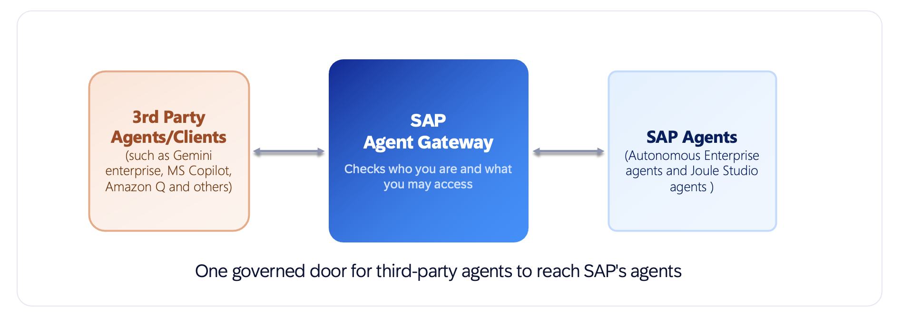
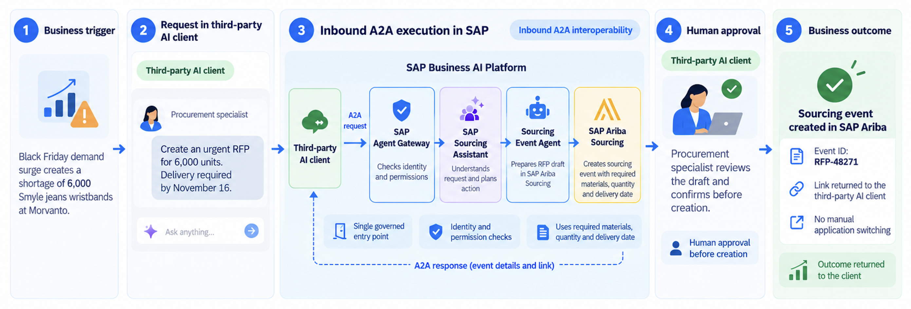
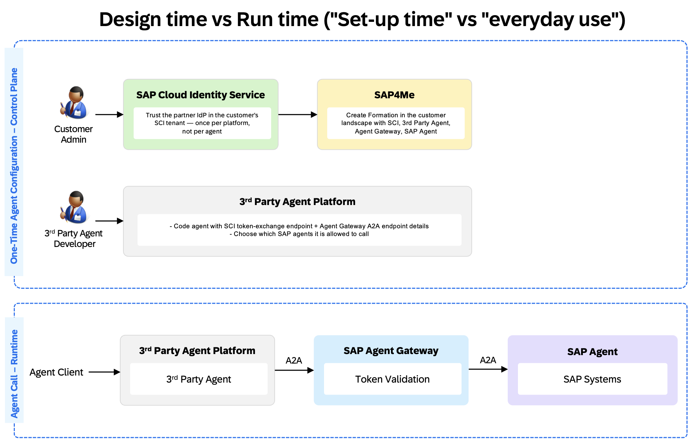
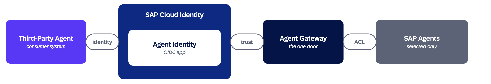
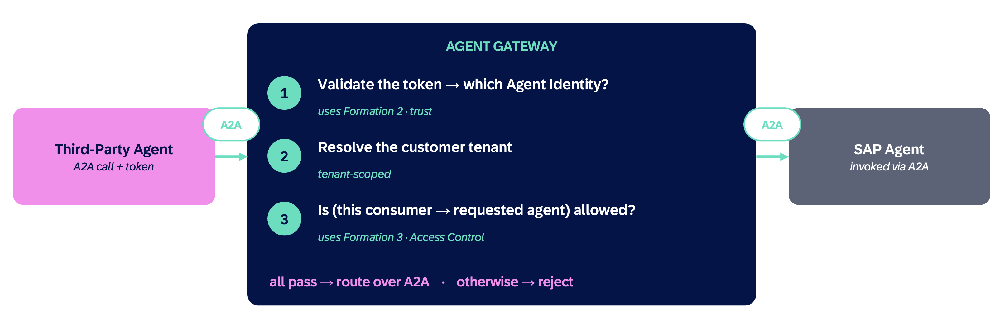

SAP announces the October 2026 general availability of inbound Agent2Agent (A2A) interoperability, connecting SAP's autonomous enterprise agents with the broader AI ecosystem through open standards and governed access.

<!-- truncate -->

## Enabling an open and interoperable enterprise AI ecosystem

Enterprise AI is moving beyond standalone assistants toward agents that collaborate across applications, platforms, and business processes. As organizations adopt agents from different providers, the challenge is not only enabling communication, but also making the right agents discoverable and ensuring that every interaction respects enterprise security and governance.

**With the October 2026 general availability (GA) of inbound A2A interoperability, third-party agents can securely invoke SAP Agents through the Agent Gateway.** Users can initiate a task in their preferred AI environment, have it handled by an SAP Agent, and receive the result without switching applications.

This extends SAP's autonomous enterprise capabilities into heterogeneous AI ecosystems while keeping business execution grounded in trusted data, processes, and authorizations.

## What's available with October 2026 GA?

The **Agent Gateway**, part of the SAP Business AI Platform, provides a single governed entry point for inbound A2A interactions. The term **SAP Agents and Assistants** covers both SAP-delivered autonomous enterprise agents and assistants across lines of business and custom agents developed using **Joule Studio**, where supported.

The release brings together three core capabilities:

- **Standards-based discovery with ARD**: The Agent Gateway implements discovery based on the open [Agentic Resource Discovery (ARD) specification](https://github.com/ards-project/ard-spec), a discovery protocol that lets an AI client ask "What is available for this task?" and receive a catalogue of matching agents. Customers can discover available SAP Agents and Assistants, each with its identifier, **AgentCard** URL, and metadata. The AgentCard then provides the specific details needed to invoke the agent, including its A2A endpoint. This removes the need for manual endpoint research.

- **Open agent interoperability with A2A**: External AI clients can use the open **Agent2Agent protocol** to delegate tasks to supported SAP Agents and receive results across platform boundaries.

- **Governed enterprise access**: Customers control which agents each external client may invoke. The Agent Gateway validates incoming requests, applies configured access restrictions, routes interactions, and supports auditability, without exposing SAP business systems directly.

**ARD helps clients discover which agents are available; AgentCards describe those capabilities and how to reach them; A2A enables the actual agent interaction.** Discovery does not itself grant permission to invoke an agent.

*Figure 1. High-level inbound A2A interoperability: the Agent Gateway provides a single governed entry point between third-party agents and SAP Agents.*

## What can this enable?

Illustrative scenarios, subject to the relevant agent capabilities and customer configuration, include:

- **Procurement**: An employee requests a sourcing event from an AI assistant. An SAP Sourcing Agent prepares the sourcing-event or RFP draft for review.

- **Finance**: An analyst asks for overdue receivables and recommended actions. An SAP finance agent evaluates outstanding items and proposes collection follow-ups.

- **Human resources**: An employee or manager requests payroll information or an HR task. An authorized SAP HR assistant retrieves the permitted information or supports the action.

The user remains in their existing assistant while specialized business capabilities execute within SAP.

### An example in practice: Black Friday sourcing at Morvanto

In an illustrative scenario, **Morvanto** faces a Black Friday demand surge and a shortage of **6,000 Smyle jeans wristbands**. A procurement specialist uses a third-party AI client to request an urgent RFP for 6,000 units, with delivery required by **November 16**.

The external client delegates the request over A2A through the **SAP Agent Gateway** to the **SAP Sourcing Assistant**. Its **Sourcing Event Agent** prepares the RFP in SAP Ariba Sourcing, using the required materials, quantities, and delivery date. Before creation, the procurement specialist reviews and confirms the draft. Once approved, the sourcing event is created and its **event ID and link** are returned to the third-party AI client, eliminating manual application switching.

*Figure 2. Illustrative inbound A2A business scenario: an urgent sourcing request is initiated in a third-party AI client, executed through SAP's governed A2A flow, approved by the procurement specialist, and created in SAP Ariba Sourcing.*

## Architecture: Discover and configure once, operate continuously

The architecture separates **design-time discovery, onboarding, and trust configuration** from runtime execution. This allows teams to establish reusable integrations without relaxing security controls on individual requests.

*Figure 3. Design time establishes identity, trust, access, and external agent connectivity. At runtime, authenticated A2A calls pass through the Agent Gateway before reaching authorized SAP Agents.*

### Design time: Discover, establish trust, and authorize

Through **ARD-based discovery in the Agent Gateway**, customers and developers can identify available SAP Agents and Assistants and access key metadata, including the agent identifier, type, version, and **AgentCard** URL. The AgentCard describes the agent's capabilities and skills and provides the A2A endpoint required to invoke it, so developers can select and connect to the appropriate integration target.

For details on how SAP's Agent Gateway exposes these discovery endpoints, see [Discovering SAP Agents Using Agentic Resource Discovery Endpoints](https://help.sap.com/docs/CROSS_DOMAIN_AGENTS/4d8be6737cf24797bf753cbcc6e2288f/418a00aac347473e866cb7987119b9f9.html?locale=en-US).
The discovery catalog is tenant-scoped and filtered by the customer's configured access control list (ACL). A technical token obtained through client credentials can be used to discover available agents, while invoking an SAP Agent requires a user token. This separates discovering an agent from performing a business operation on a user's behalf.

A customer administrator first registers the external AI client through **SAP for Me** as an **Agent Gateway Consumer**. Registration establishes the consumer's presence in the customer landscape; it does not grant access to SAP Agents.
Onboarding then uses **SAP-managed formations**, a declarative mechanism for configuring identity, trust, and authorization across the customer's landscape. Three formations are configured in sequence:

Each formation depends on the previous one: identity must exist before trust can be established, and trust must exist before access can be granted. Customers can change the permitted SAP Agents by updating the access-control formation without repeating the full onboarding process.

**Identity – Integration with SAP Cloud Identity Services**: Creates a single-tenant OpenID Connect (OIDC) Agent Identity for the registered consumer.

**Trust – Integration with Agent Gateway for Third Party**: Establishes trust between the Agent Identity and the Agent Gateway.

**Authorization – Integration with Agent Gateway Consumer**: Creates an access control list (ACL) specifying which SAP Agents the consumer is permitted to invoke, including supported SAP-delivered and Joule Studio agents.

*Figure 4. Identity, trust, and access control govern which SAP Agents a third-party agent can invoke.*

Developers configure the external platform's A2A connection and authentication flow using the discovered endpoint information. Once set up, the same trusted connection can serve subsequent business requests without repeating onboarding each time.

### Runtime: Authenticate, authorize, execute, and return

- **Initiate**: A signed-in user asks an external AI assistant to perform a business task. The external client obtains the required token through the established identity and trust configuration, including a user-bound token exchange where applicable.

- **Validate and route**: The client sends an A2A request to the Agent Gateway. On every call, the gateway (a) validates the token and identifies the trusted Agent Identity, (b) resolves the associated customer tenant, and (c) checks the configured ACL to determine whether this consumer may invoke the requested SAP Agent. Only requests passing all three checks are routed to the agent; other requests are rejected.

*Figure 5. The Agent Gateway validates the token, resolves the customer tenant, and checks access permissions before routing an inbound A2A request.*

- **Execute with user permissions**: The SAP Agent processes the task within the requesting user's applicable business authorizations. The external agent does not receive broader access to SAP data or systems.

- **Return and audit**: The result travels back through the A2A interaction to the originating assistant, with logging and audit controls providing accountability.

The key architectural principle is **end-to-end identity and customer-controlled access**: the client must be configured for the target agent, and the business operation remains limited by the signed-in user's permissions. ARD is the discovery layer; authorization and execution are enforced separately at runtime.

For scenarios requiring additional enterprise integration capabilities, **SAP Integration Suite** can complement the Agent Gateway with traffic management, API policies, and other integration patterns.

## What's next for agent interoperability?

Inbound A2A is the first milestone toward **bidirectional interoperability**. SAP's future direction includes:

- **Outbound A2A**: SAP Agents collaborating with and delegating tasks to specialized third-party agents.

- **Outbound MCP**: SAP Agents accessing external tools and business capabilities exposed through Model Context Protocol (MCP) servers.

Together, **ARD, A2A, and MCP address complementary needs: discovering capabilities, collaborating between agents, and consuming tools**. Future scope and availability will follow SAP's evolving roadmap.

## Explore the reference architectures

Detailed guidance on identity, trust, onboarding, and runtime integration patterns is available in the SAP Architecture Center:

- [Integrating Joule Agents into Your Ecosystem (Inbound A2A)](/docs/ref-arch/fe0d1d)
- [A2A and MCP for AI Agent Interoperability on SAP BTP](/docs/ref-arch/76ec36)

By combining standards-based discovery, open agent communication, and governed access, SAP is making its trusted business capabilities available in the broader enterprise AI ecosystem.
